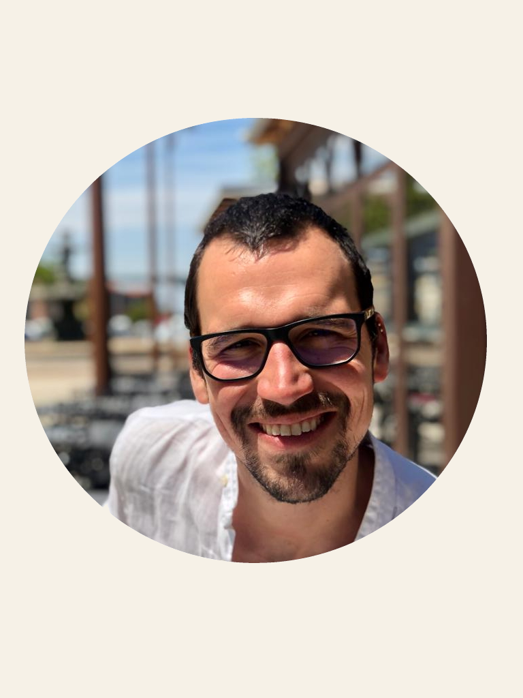
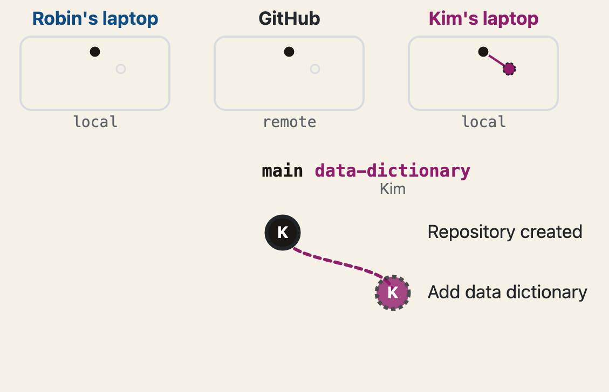
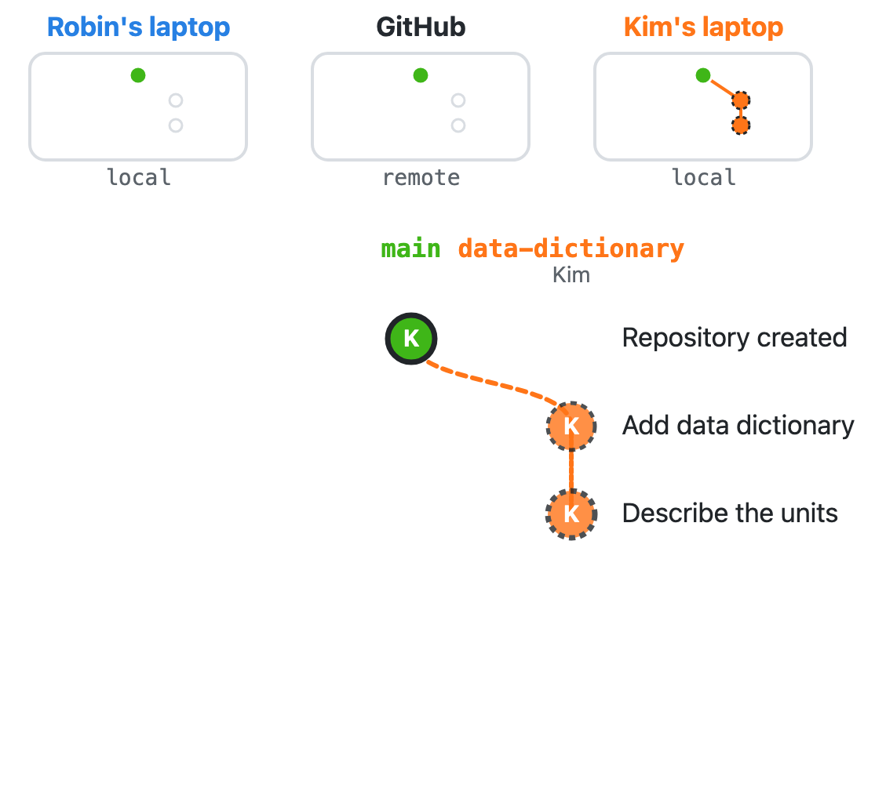
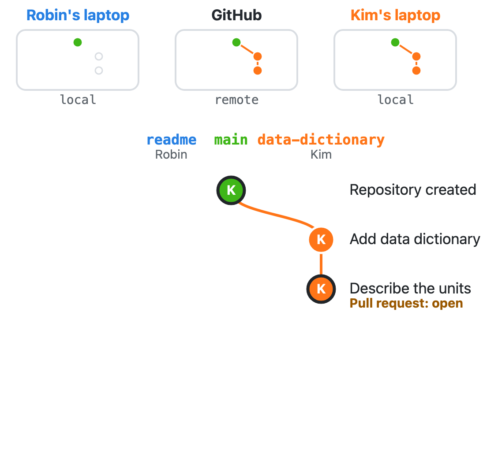
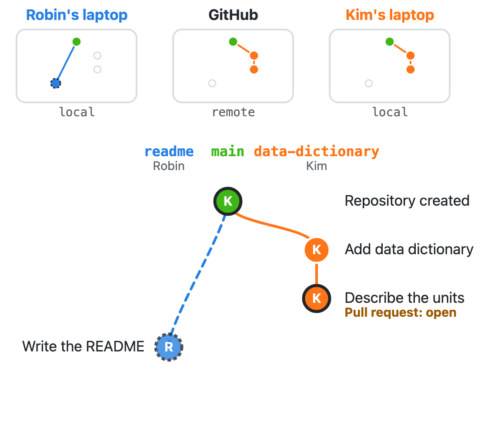
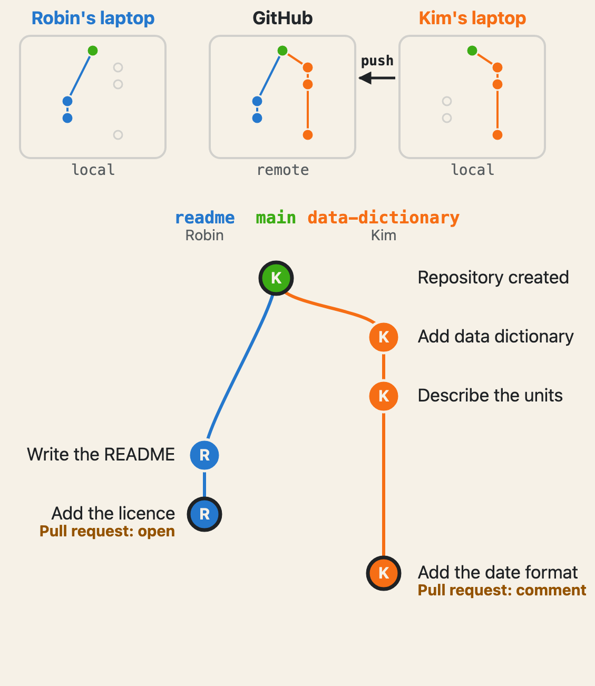
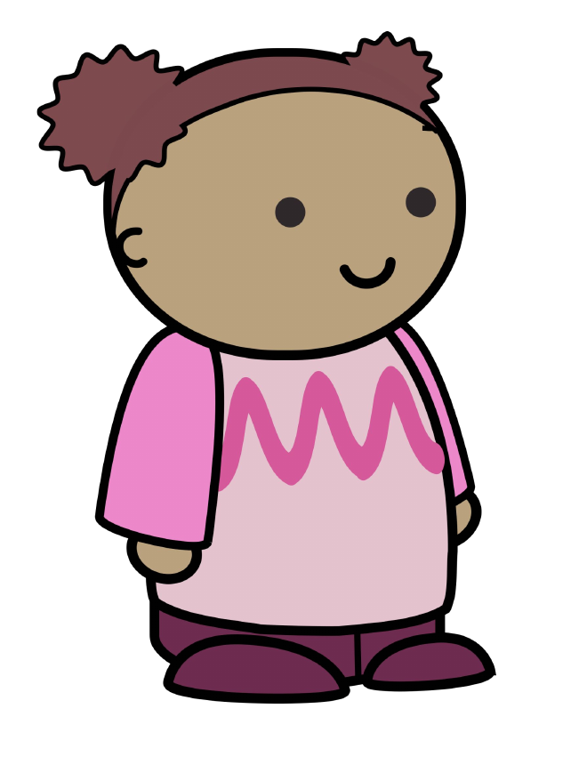

## Find your seat

:::: {.seatcards}
::: {.seatcard}
[Your username is on a table]{.who}

Your setup is finished. Sit there, and keep the seat beside you free.
:::

::: {.seatcard}
[Your username is at the door]{.who}

Take your card and sit beside someone whose card is on a table.
:::

::: {.seatcard}
[No card with your username]{.who}

Take a blank card, write your name on it and sit beside someone whose card is on a table.
:::
::::

::: key
You work together at one laptop with a finished setup, in pairs or in groups of three.
:::

::: {.aside-line style="font-size: 0.75em; margin-top: 0.4em;"}
If you like, add your name to your card and introduce yourself to your neighbour.
:::

::: {.notes}
On screen while people come in, from about 09:15. Cards with a finished setup lie on the tables, placed apart. The other username cards and the blank cards lie at the door.
:::

# Welcome {background-color="#1A1714"}

<!--
Slides for Git for Scientists at the Research Data Conference 2026, Friday
20 November 2026, 09:30 to 11:30, Bern. Layout of 19 November: part 1
(09:30 to 10:30) ends after my pull request demo, the learners' own pull
request is work for home. Part 2 (10:40 to 11:30) is the educator seat,
with one activity on a Miro board and a synthesis slide
(workshop/live.qmd, written by the skill board-synthesis, local only).
The story pictures are stills of the two-person story (Kim and Robin).
The numbers on the slide "Your preparation, in counts" are updated on
Friday morning from the tracker.
Render: quarto render workshop/slides.qmd
-->

## Lars Schöbitz

::::: columns
::: {.column width="30%"}
{width="85%" fig-alt="Portrait of Lars Schöbitz."}
:::

::: {.column width="69%"}
-   Data steward at Global Health Engineering, ETH Zurich
-   RStudio certified instructor since 2020
-   I teach people who have never written code or used Git
:::
:::::

::: {.notes}
Block 09:30 to 09:40. Three facts. No more here.
:::

## Two seats today

::::: columns
::: {.column width="49.5%"}
### Learner, until 10:30

You make a commit of your own and watch a file travel into a shared repository.
:::

::: {.column width="49.5%"}
### Educator, from 10:40

You look at how this workshop is built and taught, and you give feedback on it.
:::
:::::

::: key
From now on, watch **how** I teach. After the break you write it down.
:::

::: {.notes}
Block 09:30 to 09:40. Say both seats out loud. The feedback after the break follows four words: content, presentation, interaction, preparation.
:::

# Who is in the room {background-color="#1A1714"}

## Who is in the room: Git

How much have you used Git? Your answers in the survey (n&nbsp;=&nbsp;27).

::: {.numbers}
::: {.number}
[7]{.big} never
:::

::: {.number}
[7]{.big} now and then
:::

::: {.number}
[4]{.big} regularly
:::

::: {.number}
[9]{.big} extensively
:::
:::

::: key
Half of you are new to Git or use it now and then.
:::

::: {.notes}
Block 09:30 to 09:40, the survey slides in about 3 minutes. 27 answers, everyone who completed the survey. 15 macOS, 11 Windows, 1 Linux. The cards on the tables mark a laptop with a finished setup. They say nothing about experience.
:::

## Who is in the room: roles

Your role, from the survey (n&nbsp;=&nbsp;27).

::: {.numbers}
::: {.number}
[10]{.big} data stewards
:::

::: {.number}
[5]{.big} researchers
:::

::: {.number}
[2]{.big} librarians
:::

::: {.number}
[10]{.big} other roles
:::
:::

::: key
**16** of you teach Git or plan to. That is why the second half is about teaching.
:::

::: {.notes}
Block 09:30 to 09:40. Other roles: IT, research software engineer, trainer, and people who chose other.
:::

## What you want to take away

Your open answers, in groups (n&nbsp;=&nbsp;27). Four answers fall outside these groups.

::: {.numbers}
::: {.number}
[9]{.big} teach Git better, to mixed groups
:::

::: {.number}
[8]{.big} a solid foundation of my own
:::

::: {.number}
[3]{.big} support researchers who use Git
:::

::: {.number}
[3]{.big} Git and AI tools
:::
:::

::: {.notes}
Block 09:30 to 09:40. Groups only, no single answers: the survey promised that. Four answers fall outside these groups (collaboration in a team, repairing mistakes).
:::

## Git and AI tools

Three of you asked for it:

-   When to use an AI assistant, and when not
-   Testing and collaboration on GitHub when an agent writes the code
-   How to declare the use of AI tools in research

::: key
The foundation we learn in the full course (two sessions of 2 hours) prepares you for our Agents for Scientists workshop, where we invite an agent, such as Claude Code, to work with us.
:::

::: {.notes}
Block 09:30 to 09:40, last slide of it. 25 of the 27 answers name at least one AI tool in use. The three asks are grouped from the open answers, no quotes.
:::

# How we work today {background-color="#1A1714"}

## How we work

[My turn]{.turn .my} I show something on my screen. You watch and type nothing.

[Our turn]{.turn .our} We do the same step at the same time, I on my screen, you on yours.

[Your turn]{.turn .your} You work on a task, with your neighbour. I help where it sticks.

::: key
Things may [go wrong]{.mark-word} here. Everything we do today can be undone.
:::

::: {.notes}
Block 09:40 to 09:45, with the next two slides. This is the method of the course. From here on, the label at the top of a slide says who works.
:::

## Today

| Time  | What                                                             |
|-------|------------------------------------------------------------------|
| 09:45 | **Git for Scientists, session 1, as I teach it**                 |
|       | What is a commit? Your commits, then a commit of your own        |
| 10:15 | Branch and pull request. I show it in the shared repository      |
| 10:30 | Break                                                            |
| 10:40 | **How it is built and taught**                                   |
|       | Your feedback, how I teach, what motivates learners              |
| 11:25 | An offer, and your answer as a commit                            |

::: {.notes}
Block 09:40 to 09:45. Say it: from 09:45 to 10:30 you get the first session of the course, the way people new to Git get it. From 10:40 we take it apart. Questions that have no room go on the board; two spots for live questions, at 10:10 and at 11:00.
:::

## One board for the room

[Your turn]{.turn .your} 2 minutes

::: task
1.  Open the workshop website: <https://gitforsci-rdc.github.io/website/>
2.  Click **Workshop board** in the top bar. No account, no name.
3.  In the frame **First note**, add one note: one thing from the conference so far that stays with you.
:::



::: key
An AI session (Claude) on my laptop reads your notes and groups them. No names, nothing personal on a note.
:::

::: {.notes}
Block 09:40 to 09:45. Wait until notes appear. Then point to the frame Parked questions: any time, one question per note. Paper sticky notes are on the tables for whoever prefers them or if the board fails. Not every parked question gets an answer in two hours; the open ones get one by email.
:::

# Git for Scientists, session 1 {background-color="#1A1714"}

## What is a commit?

A commit is a saved state of your files, with four pieces of information:

::: incremental
-   **Who** made it: a name and an email address
-   **When**: date and time
-   **What** changed: line by line
-   **Why**: the message you write with it
:::

::: {.notes}
Block 09:45 to 09:55. Key words only, then the traces in a real repository on the next slide.
:::

## Traces in a real repository

[My turn]{.turn .my} The commits of the workshop website:

-   9 November: pre-work steps 1 and 2
-   15 November, a Sunday, 22:00: steps 3 to 5
-   17 November: step 6
-   19 November, the day before: these slides, 19 commits

::: task
At what times of day did Lars prepare this material?
:::

::: {.fragment}
::: key
Git forgets nothing. 34 commits until last night: 19 of them yesterday, 7 at 22:00 or later.
:::
:::

::: {.notes}
Block 09:45 to 09:55. The repository is public: gitforsci-rdc/website. No browser needed, the slide carries it. Git forgets nothing: that is the use of it, and it is the reason to choose what goes into a commit. The history shows that my instructions came late. This returns at 10:55.
:::

## One repository, several places {.story}

::: {.r-stack}
{.fragment .fade-in width="88%" fig-alt="Three boxes: Robin's laptop and Kim's laptop are empty and dashed, with the words no copy yet. The box GitHub holds one commit. Below the laptops stands local, below GitHub stands remote. Underneath, the commit graph with the first commit, Repository created, on main."}

{.fragment .fade-in width="88%" fig-alt="From GitHub, one arrow with the word clone points to Robin's laptop and one to Kim's laptop. All three boxes now hold the same commit."}
:::

::: legend
Pictures: Lars Schöbitz, CC BY 4.0. **K** is Kim, **R** is Robin. Dashed: only on the laptop.
:::

::: {.notes}
Block 09:45 to 09:55. Kim creates the repository on GitHub. Kim and Robin clone: three places, the same state. Laptops never talk to each other directly, always through GitHub. Words: local is the laptop, remote is GitHub. Clone once. A second clone is a second copy on the same laptop, and the two get mixed up.
:::

## Your commits in GitHub Desktop

[Our turn]{.turn .our}

::: task
1.  Open **GitHub Desktop**.
2.  Choose your repository `teaching-your-username` at the top left.
3.  Click the tab **History**.
:::

Your commits from the pre-work: who, when, what, why.

::: key
Three commits? Show your neighbour.
:::

::: {.notes}
Block 09:55 to 10:00, with the next slide. Whoever has not finished the pre-work looks at the neighbour's screen. Show the same view in the demo repository.
:::

## Your commits on GitHub

[Your turn]{.turn .your} 3 minutes

::: task
1.  In GitHub Desktop: menu **Repository**, **View on GitHub**.
2.  Click the clock with the number, for example **3 Commits**.
3.  Show your neighbour one commit: who, when, what, why.
:::



::: key
Your laptop and GitHub hold the same commits.
:::

::: {.notes}
Block 09:55 to 10:00. I show the two clicks once as rainbow-train, then the room. Without pre-work: look at the neighbour's screen.
:::

## A commit, step by step

[My turn]{.turn .my} Watch, type nothing.

1.  Menu **Repository**, **Open in Sublime Text**
2.  One line more in `rainbow-train.md`, save
3.  Tab **Changes**: the line shows in green
4.  A message, then **Commit to main**
5.  **Push origin**

::: {.notes}
Block 10:00 to 10:10, with the next slide. All five steps as rainbow-train, without stopping, about 2 minutes. Then the next slide: the same for the room.
:::

## A commit of your own

[Your turn]{.turn .your} 5 minutes

::: task
1.  In GitHub Desktop: menu **Repository**, **Open in Sublime Text**.
2.  In `your-username.md`, add one line at the end and save:

    `- What I want to take away today:`
3.  Tab **Changes**: your line shows in green.
4.  Write a message, click **Commit to main**.
5.  Click **Push origin**.
:::



::: {.key .beside}
On GitHub: one commit more. Then a sticky note on the lid.
:::

::: {.notes}
Block 10:00 to 10:10. I walk the room. No Sublime Text: menu Repository, Show in Finder (Windows: Show in Explorer), open the file with TextEdit or Notepad. Push rejected: the commit carries the real email address, and the account blocks such pushes. In GitHub Desktop: Settings (Windows: File, Options), Git, tab Author, choose the address ending in users.noreply.github.com, Save. Then Undo at the bottom of Changes and commit again. Check for everyone: View on GitHub, the number beside the clock is one higher. This step returns at 11:25.
:::

## Questions so far

One or two now, out loud.



::: key
Everything else: a note under **Parked questions**.
:::

::: {.notes}
Block 10:10 to 10:15, with the terminal slides. The first of two spots for live questions; the second is at 11:00.
:::

## The same in the terminal

[My turn]{.turn .my}

<pre class="terminal">$ git status
On branch main
Your branch is up to date with 'origin/main'.

nothing to commit, working tree clean

$ git log --oneline
5d0c1e2 Add what I want to take away
3d0719b Describe this repository
0485b82 Add my teaching context
c93273e Initial commit</pre>

The terminal shows the same repository as GitHub Desktop, as text.

::: {.notes}
Block 10:10 to 10:15. Live: in GitHub Desktop, menu Repository, Open in Terminal. Type git status and git log --oneline. No push from the terminal (larnsce is signed in there). One sentence: an agent such as Claude Code works this way.
:::

## A button is a command

| In GitHub Desktop         | The command   |
|---------------------------|---------------|
| History                   | `git log`     |
| Changes                   | `git status`  |
| Commit to main            | `git commit`  |
| Push origin               | `git push`    |
| Fetch origin, Pull origin | `git pull`    |

::: key
What you learn today carries over to the tool you teach with.
:::

::: {.notes}
Block 10:10 to 10:15. The same names in RStudio, Positron and VS Code. You type nothing.
:::

# Branch and pull request {background-color="#1A1714"}

## A branch, then a pull request {.story}

::: {.r-stack}
{.fragment .fade-in fig-alt="Kim has created the branch data-dictionary. Beside main, the graph has a column data-dictionary, without a commit of its own yet."}

{.fragment .fade-in fig-alt="A first commit, Add data dictionary, on the branch data-dictionary, drawn dashed. It exists only in the box Kim's laptop."}

{.fragment .fade-in fig-alt="A second commit, Describe the units, also dashed and only on Kim's laptop."}

{.fragment .fade-in fig-alt="An arrow with the word push points from Kim's laptop to GitHub. The two commits of the branch are now solid and also on GitHub."}

{.fragment .fade-in fig-alt="Kim has opened a pull request. Below the newest commit of the branch data-dictionary stands Pull request: open. The graph is otherwise unchanged."}
:::

::: {.notes}
Block 10:15 to 10:20, this slide and the next. One sentence per picture. Branch: a line of work of your own, main stays untouched. A commit, another commit, only then the push: solid, now also on GitHub. Pull request: the request to take the branch into main. In the picture it stands below the newest commit.
:::

## Robin works at the same time {.story}

::: {.r-stack}
{.fragment .fade-in fig-alt="Robin has created the branch readme on the left, without a commit of its own yet."}

{.fragment .fade-in fig-alt="Robin's first commit, Write the README, dashed and only on Robin's laptop."}

{.fragment .fade-in fig-alt="Robin's second commit, Add the licence, also only on Robin's laptop."}

{.fragment .fade-in fig-alt="An arrow with the word push points from Robin's laptop to GitHub. Robin's two commits are now also on GitHub."}

{.fragment .fade-in fig-alt="Robin has opened a pull request too. Below the newest commits of both branches stands Pull request: open. Robin's laptop lacks Kim's commits, Kim's laptop lacks Robin's commits. GitHub holds all of them."}
:::

::: {.notes}
The same steps for Robin, one after the other. Last picture: each person has a branch of their own, which is why yours is named people-username. GitHub holds everything, each laptop only its own work.
:::

# The shared repository {background-color="#1A1714"}

## From yours into the shared one

::::: columns
::: {.column width="49.5%"}
### Before

Your three lines are in your own repository, in `your-username.md`.
:::

::: {.column width="49.5%"}
### After

The same file is in the repository `workshop`, on a branch of your own. A pull request asks to take it into `main`.
:::
:::::

::: key
You copy the file, not the folder.
:::

::: {.notes}
Block 10:20 to 10:30, with the demo and the last two slides.
:::

## A file goes into the shared repository

[My turn]{.turn .my} Lean back and watch. I work as rainbow-train, a participant like you.

1.  Open the repository `workshop`, click **Fetch origin**
2.  Create the branch `people-rainbow-train`
3.  Copy the file `rainbow-train.md` into the folder `people`
4.  Commit
5.  Publish the branch
6.  Open the pull request and request a reviewer

::: {.notes}
Block 10:20 to 10:30. One pass, about 5 minutes, and say these out loud:
1. You cloned workshop in Step 5. Do not clone it again. Current Repository, workshop.
2. Current Branch, New Branch. The button at the bottom left must end in "to people-your-username". If it ends in "to main", you are on the wrong branch.
3. In Finder or Explorer: gitrepos/teaching-username, copy the one file, paste into gitrepos/workshop/people.
4. Changes shows one file with a tick.
5. Publish branch.
6. Preview Pull Request, then Create Pull Request at the bottom right. The browser opens. Fill in the two lines. On the right, Reviewers: larnsce.
The room does not type here. Say it: this is your part at home, and the page has every step.
:::

# Review and merge {background-color="#1A1714"}

## A second person reads {.story}

::: {.r-stack}
{.fragment .fade-in fig-alt="Robin has read Kim's pull request and written a comment. Below Kim's newest commit stands Pull request: comment."}

{.fragment .fade-in fig-alt="Kim has answered with one more commit, Add the date format. It is dashed and only on Kim's laptop."}

{.fragment .fade-in fig-alt="Kim has pushed. The commit Add the date format is now also on GitHub and belongs to the open pull request."}

{.fragment .fade-in fig-alt="The pull request is merged. On main there is a merge commit that takes in Kim's three commits. Below Kim's newest commit stands Pull request: merged. The merge commit exists only on GitHub."}
:::

::: {.notes}
Block 10:20 to 10:30. Comment, commit, push, merge, one after the other, pictures only. No live review today.
:::

## Your turn is at home

::: task
1.  Open the page **Add your file** on the workshop website.
2.  Bring your file into the repository `workshop` with a pull request.
3.  Request **larnsce** as the reviewer.
:::

::: key
I read every pull request that is open by **Friday 4 December** and write one question on it.
:::

::: aside-line
In the full course you do this in the room, right after the break. I walk the room and check in with each person. Online, I visit each break-out room.
:::

::: {.notes}
Block 10:20 to 10:30, last slide before the break. About 30 minutes at home. In the room it is the first activity after the break with real learners: it gives me the time to walk the room and take questions one to one. The course is built in two sessions with time between them to practise. Today is the first session only. In the second session pairs review and merge each other's work, 30 minutes of it; it is the part I would never cut from a full course.
:::

## Break

Until 10:40.



::: key
After the break: your feedback. One thing that went well, one that can be improved.
:::

# The educator seat {background-color="#1A1714"}

## Feedback on my talk yesterday

|                  | What went well                         | What can be improved                              |
|------------------|----------------------------------------|---------------------------------------------------|
| **Content**      | Every number came from public data     | It stayed unclear what "embedded" means in practice |
| **Presentation** | One number per slide                   | No clear thread from the keynote to my talk       |
| **Interaction**  | One question to the room at the end    | No time left for your questions                   |
| **Preparation**  |                                        | Too many emails before this workshop              |

::: legend
Rubric: Greg Wilson, Teaching Tech Together, slides on feedback, CC BY 4.0. The row Preparation is my addition.
:::

::: {.notes}
Block 10:40 to 10:45. Asking for feedback yourself, with your own questions, is the first advice in the book. These are my own notes on my talk of Thursday; the last cell is about this workshop and is already on the board. Read the right column out loud. Danish clapping fits here if the room needs it.
:::

## Activity 1: feedback on this workshop

[Your turn]{.turn .your} The first hour, and the pre-work before it.

::: task
1.  **Think**, alone, 2 minutes: what went well, what can be improved?
2.  **Pair**, 3 minutes: tell your neighbour.
3.  **Share**, 5 minutes: on the board, frame **Activity 1**. One point per note, in the cell where it fits.
:::



::: key
At least two notes under **What can be improved**.
:::

::: {.notes}
Block 10:45 to 10:55. Call the three steps out loud at 2 and at 5 minutes. When the countdown ends, type in the second window: /board-synthesis rubric. Then go on with the next two slides while it runs.
:::

## How this workshop is built

| What you saw                       | What it is                                         |
|------------------------------------|----------------------------------------------------|
| The website with the six steps     | A repository, built into a site on every merge     |
| The invitation to the organisation | A script that reads the usernames from the survey  |
| Your issue with five boxes         | A script, one issue per person from one template   |
| The comment after you ticked a box | A watcher that looks every 10 minutes              |
| These slides                       | A text file in the repository of the website       |

::: key
The next cohort gets a new copy. The content changes each time, for the people who come.
:::

::: {.notes}
Block 10:55 to 11:00, this slide and the next, while the synthesis of activity 1 runs. Everything you used this week is a repository. One sentence per row. The survey is a small app with its answers in a database. One course organisation on GitHub for you, one for the material, one for the administration. The point: the workshop teaches the tool it is built with, and every step you took left a trace I could see without asking.
:::

## Your preparation, in counts

<!-- COUNTS: update on Friday 20 November, 08:30, from the tracker -->

Friday 20 November, 07:00. Four emails from me.

::: {.numbers}
::: {.number}
[27]{.big} answered the survey
:::

::: {.number}
[26]{.big} joined the organisation
:::

::: {.number}
[17]{.big} ticked all five boxes
:::

::: {.number}
[17]{.big} made a commit from the laptop
:::
:::

::: {.fragment}
On Tuesday at 15:00 the last two numbers were 7 and 2. Most of the work happens in the last hours, this time also because my instructions came late.
:::

::: {.notes}
Block 10:55 to 11:00. Counts only, no names, no chart of who worked when. Say that the pre-work decided who could type today.
:::

## What you wrote

Your notes from activity 1, grouped. I switch to the second tab.

::: task
Read it with your neighbour: which point surprises you?
:::

::: key
Then the floor is open, for what you wrote and for your questions.
:::

::: {.notes}
Block 11:00 to 11:10. Switch to the browser tab with live.html: it shows the result after the skill ran. Give the room a minute to read. Read one theme per row from each column out loud, then open it: who wants to say more on a point under What can be improved? Questions from the frame Parked questions fit here too. If the synthesis failed: open the board itself and read three notes per cell. Do not defend, say thank you and name one thing I will change.
:::

# How I teach {background-color="#1A1714"}

## Six things I do

::: incremental
-   **Words I leave out:** [just]{.mark-word} [easily]{.mark-word} [quickly]{.mark-word}
-   **Design for the novice:** every click is written down
-   **Know the learners, then design:** survey first, content last
-   **A learner account:** every demo ran as rainbow-train
-   **Type with the room,** mistakes included
-   **Try out new things:** today the board and its synthesis
:::

::: aside-line
Each one has a slide of its own at the end of this deck.
:::

::: {.notes}
Block 11:10 to 11:15. One sentence per point, each with its example from this morning. Clicks are usually written down with screenshots, which are missing this time. The content of today was written yesterday. Found one of the three words on my slides or in the pre-work? Park it on the board, I fix it in a commit after the workshop.
:::

# Motivation {background-color="#1A1714"}

## What motivates adults to learn

::::: columns
::: {.column width="28%"}
{width="80%" fig-alt="A drawn figure of a child with two hair buns, smiling."}
:::

::: {.column width="71%"}
::: incremental
-   **Self-efficacy:** I am in control of my own life.
-   **Utility:** This will help me meet my goals.
-   **Community:** People I know are learning this with me.
:::

::: {.fragment}
::: aside-line
This morning: a repository of your own, your own three lines, a neighbour.
:::
:::
:::
:::::

::: legend
Figure and wording: Greg Wilson, Teaching Tech Together, slides on motivation, CC BY 4.0. Art from openclipart.org.
:::

::: {.notes}
Block 11:15 to 11:20, this slide and the next. Motivation is the strongest predictor of whether an adult learns something.
:::

## What takes motivation away

::::: columns
::: {.column width="74%"}
::: incremental
-   **Unpredictability:** what I do does not seem to affect the outcome.
-   **Unfairness:** the teacher plays favourites.
-   **Indifference:** nobody cares. A question in an issue stays without an answer. The material was last touched two years ago.
:::
:::

::: {.column width="25%"}
{width="90%" fig-alt="The same drawn figure, frowning."}
:::
:::::

::: {.fragment}
::: key
Which of the three do your learners meet most often?
:::
:::

::: legend
Figure and wording: Greg Wilson, Teaching Tech Together, slides on motivation, CC BY 4.0. Art from openclipart.org.
:::

::: {.notes}
Block 11:15 to 11:20. A push that is rejected without a reason I can read is unpredictability. An instructor who answers only the fast people is unfairness. Indifference is also: nobody notices that you fell behind in the pre-work. Ask for one hand per heading. One moment of my own if there is room: a course where the setup failed and the instructor went on.
:::

# What stays {background-color="#1A1714"}

## The full course

| | |
|---|---|
| **Session 1**, 2 hours | What you saw today, and your own pull request in the room |
| **Two weeks between** | A repository of your own, with me as reviewer. Practice in a game with quizzes. A glossary. |
| **Session 2**, 2 hours | Pairs review and merge. A merge conflict. Working together: tasks and projects, organisation and profile. |

::: key
Today you saw half of session 1.
:::

::: {.notes}
Block 11:20 to 11:25, with the next two slides. The two weeks are where people learn it: they bring a project of their own and I review it. The game and the glossary exist in German so far, from the course of Tuesday: gitklar.ch/spiel. An English glossary for this website is in work.
:::

## Also on my list

::: incremental
-   **Peer instruction:** people explain to each other and review each other's work. It is the pull request in pairs that you did not do today.
-   **A place for questions,** and the plain statement that a short workshop does not answer all of them.
-   **Online:** a short visit to each break-out room.
:::

## Where this comes from

-   [Ten quick tips for teaching programming](https://doi.org/10.1371/journal.pcbi.1006023), Brown and Wilson, 2018
-   [Teaching Tech Together](https://teachtogether.tech/), Greg Wilson, free to read
-   [The Carpentries Instructor Training](https://carpentries.github.io/instructor-training/), open material and a certification

::: key
If you teach a technical tool, take an instructor training.
:::

::: {.notes}
Block 11:20 to 11:25, last slide of it. It is the best use of your time, out of respect for the time your learners give you. My own route was the RStudio instructor certification in 2020, built by Greg Wilson on the same material; it changed how I teach novices. The Carpentries training is the open route today.
:::

## Would you teach this?

[Your turn]{.turn .your} I would like to offer a workshop for people who teach Git: this design, its scripts and its material, for your own groups.

::: task
In `your-username.md`, add one line, then commit and push:

`- Teach the teachers: yes / maybe / no. What I would need:`

If you like, a second line:

`- A moment in a course that took my motivation away:`
:::



::: aside-line
Your answer commits you to nothing.
:::

::: {.notes}
Block 11:25 to 11:30, with the last slide. The step of 10:00, this time alone. The second line is a choice: unlike a note on the board, a commit carries your name. No laptop setup: a note under Parked questions. The form of the offer is open; the answers shape it. They arrive as commits, which I can read with the tracker.
:::

# Thank you {background-color="#1A1714"}

## Thank you

-   Website and slides: [gitforsci-rdc.github.io/website](https://gitforsci-rdc.github.io/website/)
-   Licence CC BY 4.0. Take it, change it, teach with it.

[Lars Schöbitz](https://lse.de/)

-   [github.com/larnsce](https://github.com/larnsce)
-   [linkedin.com/in/larsschoebitz](https://www.linkedin.com/in/larsschoebitz)
-   Newsletter, in German and English: [buttondown.com/bitz](https://buttondown.com/bitz)

::: ack
**Cite as:** Schöbitz, L. (2026). Git for Scientists (v1.0.0). Zenodo. <https://doi.org/10.5281/zenodo.21703566>

**Funding and support:** [Swiss Reproducibility Network (SwissRN)](https://www.swissrn.org/contents/community/nodes/) local node at ETH Zurich & [Data Stewardship Network at ETH Zurich](https://library.ethz.ch/en/researching-and-publishing/data-management-and-policies/research-data-management/data-stewardship.html), funded by the [swissuniversities Open Science Programme](https://www.swissuniversities.ch/en/topics/open-science/open-science-programme) & [Global Health Engineering group at ETH Zurich](https://ghe.ethz.ch/)
:::

::: {.notes}
11:30. Your pull request at home: the page Add your file on the website. Parked questions without an answer get one by email. The board stays open until the evening, then I close it. Slides made with revealjs and Quarto.
:::

# More on how I teach {background-color="#1A1714"}

## Words I leave out

[just]{.mark-word} &nbsp; [easily]{.mark-word} &nbsp; [quickly]{.mark-word}

::: incremental
-   They say that a step costs nothing. A learner who is stuck on it hears: it is me.
-   This morning: look for one of them on my slides or in the six steps of the pre-work. Found one? Park it on the board.
:::

::: {.notes}
Not shown on 20 November, for reading. If someone finds one, thank them and fix it in a commit after the workshop.
:::

## Design for the novice

::: incremental
-   Assume that people know nothing about the tool.
-   No gap between two steps: every click is written down, usually with screenshots. They are missing this time.
-   Extra material for people with experience, marked as extra.
:::

::: aside-line
This morning: six pre-work steps with every click. "A button is a command" was the extra for those who use a terminal.
:::

::: {.notes}
Not shown on 20 November, for reading. The pre-work is where the novice design lives: a first-time user went from no account to a pushed commit in about an hour.
:::

## Know the learners, then design

::: incremental
-   A survey before anything is written: 27 answers decided the software.
-   A tracker shows who is where in the pre-work, without asking anyone.
-   The content of today was written yesterday, from what I read in the pre-work.
:::

::: {.notes}
Not shown on 20 November, for reading. Most learners do the pre-work on the last day, and I teach better from what I read then than from a plan made weeks ago. It takes practice, and trust in the method, to walk into a room with slides that are one day old. The method is fixed (My turn, Our turn, Your turn, pairs, a learner account), the content moves with the group. Next slide: one choice the survey led to.
:::

## Why GitHub Desktop?

::: {.numbers}
::: {.number}
[11]{.big}

RStudio
:::

::: {.number}
[6]{.big}

GitHub Desktop
:::

::: {.number}
[4]{.big}

Positron
:::

::: {.number}
[5]{.big}

no preference
:::
:::

::: key
I chose against the largest group. For novices, RStudio is too much on top of Git unless I teach R and Quarto alongside.
:::

::: {.notes}
Not shown on 20 November, for reading. Half of the room does not write code in R, and 10 of you do not use Git today. GitHub Desktop needs no programming language, and its buttons carry the names of the commands. I learned it in earlier workshops. The honest version: the choice has a cost for the 11.
:::

## A learner account

::: incremental
-   Every demo this morning ran as **rainbow-train**: a second account with the rights you have, on the screens you see.
-   With my own account I am an owner. Buttons differ, warnings never show.
-   The account found the rejected push with the real email address before you did.
:::

::: {.notes}
Not shown on 20 November, for reading. Costs one free account and one more browser profile.
:::

## Type with the room, mistakes included

::: incremental
-   Participatory live coding: I type, you type, nothing is pasted.
-   A demo in two passes where time allows: once without stopping, once slowly.
-   A mistake on my screen is a moment to take apart together.
:::

::: {.notes}
Not shown on 20 November, for reading. Then the next slide: the mistakes of Tuesday, and what they changed for today.
:::

## Try out new things

::: incremental
-   I used a Miro board for the first time, because Claude can now set it up for me.
-   The synthesis of your notes was a trial.
:::

::: key
Inspire yourself and your learners with novelty, and learn new things along the way.
:::

::: {.notes}
Not shown on 20 November, for reading. Say it at point six of the slide "Six things I do".
:::

## The same design, three days ago

Tuesday: the same design in German, online, for 16 people who do not write code.

::: incremental
-   **13 pull requests** in two hours
-   **Three clones** on one laptop: "clone once" is now in Step 6
-   **A copied repository folder:** today you copy one file
-   **The real email address** in first commits: Step 4 now comes first
-   **Too many emails** before the workshop
:::

::: {.notes}
Not shown on 20 November, for reading. The second cohort stays unnamed. Each line is a change you met this week: the instructions you followed are three days old.
:::
