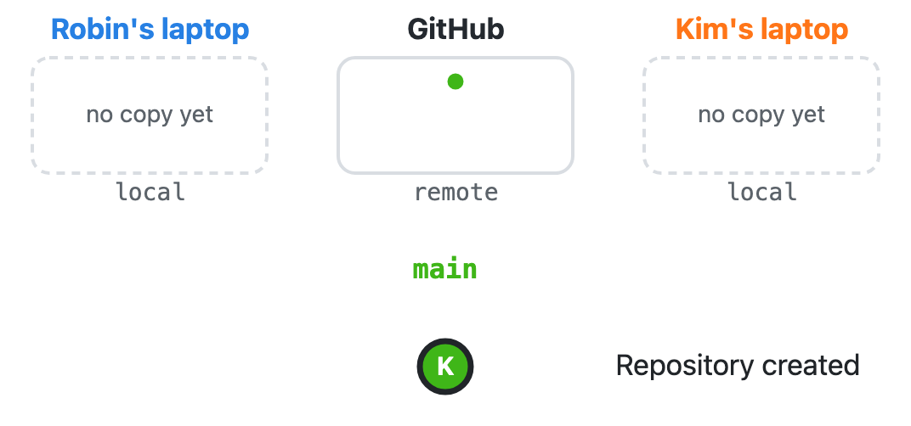
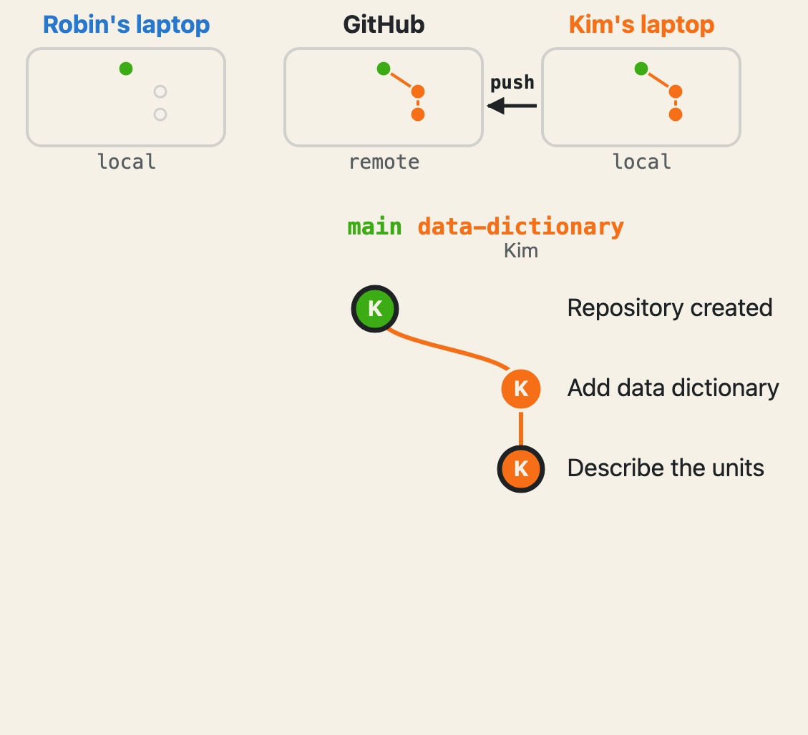
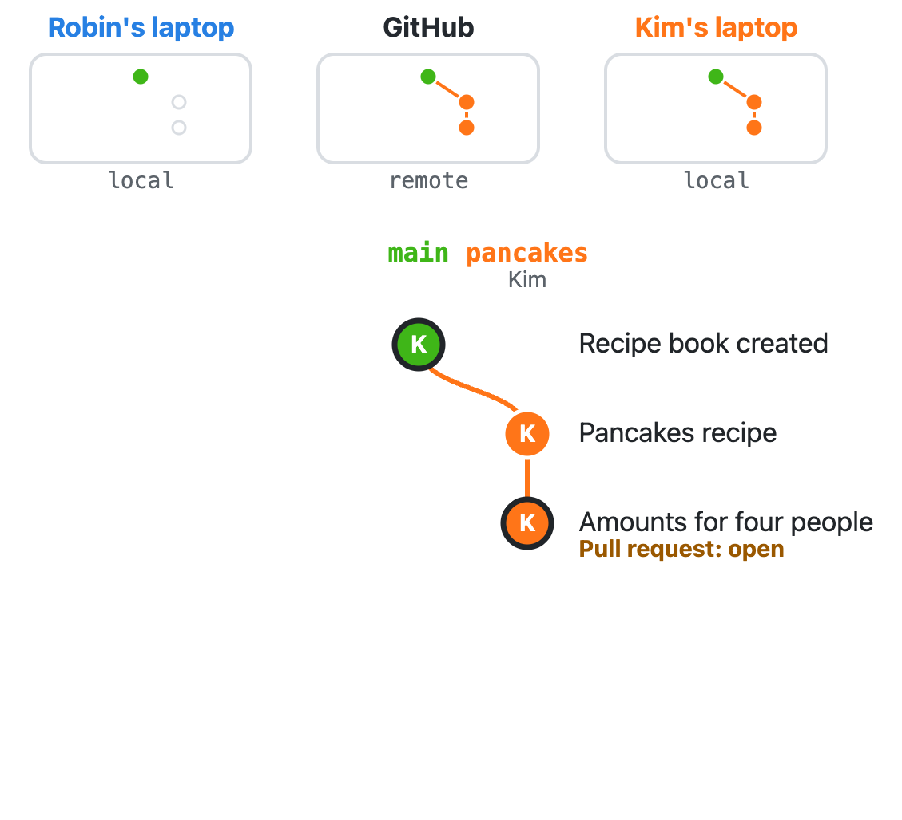
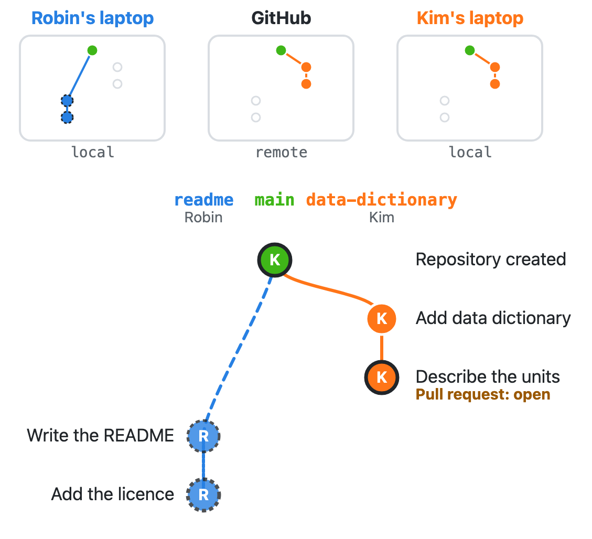
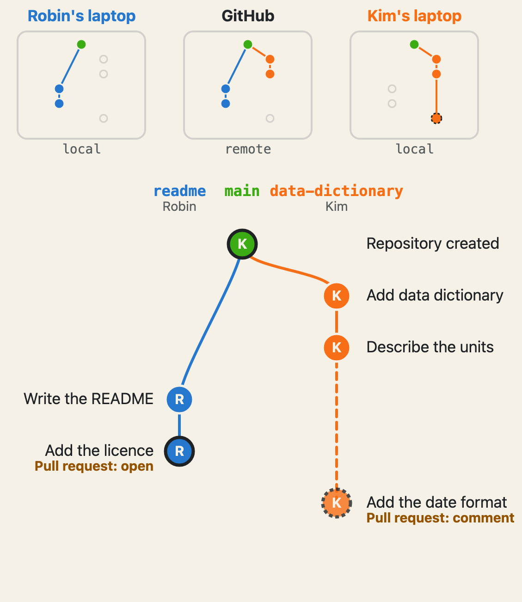
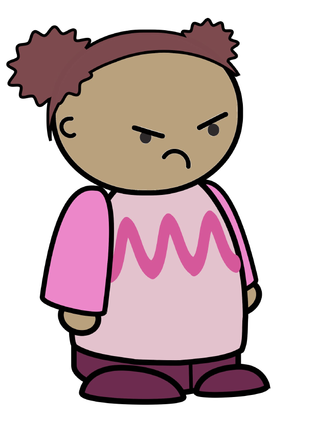

<!--
Slides for Git for Scientists at the Research Data Conference 2026, Friday
20 November 2026, 09:30 to 11:30, Bern. Layout of 19 November: part 1
(09:30 to 10:30) ends after my pull request demo, the learners' own pull
request is work for home. Part 2 (10:40 to 11:30) is the educator seat,
with two activities on a Miro board and a synthesis slide for each
(workshop/live.qmd, written by the skill board-synthesis, local only).
The story pictures are stills of the two-person story (Kim and Robin).
The numbers on the slide "Your preparation, in counts" are updated on
Friday morning from the tracker.
Render: quarto render workshop/slides.qmd
-->

# Welcome {background-color=""}

## Lars Schöbitz {.smaller}

::::: columns
::: {.column width="30%"}
{width="85%" fig-alt="Portrait of Lars Schöbitz."}
:::

::: {.column width="69%"}
-   Data steward at Global Health Engineering, ETH Zurich
-   RStudio certified instructor since 2020
-   I teach people who have never written code or used Git

::: aside-line
I finished these slides yesterday. That is on purpose, and at 11:10 I say why.
:::
:::
:::::

::: {.notes}
Block 09:30 to 09:40. Three facts, one sentence on the day before. No more here.
:::

## Two seats today {.smaller}

You sit on two seats at the same time.

::::: columns
::: {.column width="49.5%"}
### Learner

09:40 to 10:30

Commit, branch and pull request: you make a commit of your own and watch a file travel into a shared repository.
:::

::: {.column width="49.5%"}
### Educator

10:40 to 11:30

You look at how this workshop is built and taught, and you give feedback on the first hour.
:::
:::::

::: task
From now on, watch **how** I teach: what I say, how I say it, how I run the room. After the break you write it down.
:::

::: {.notes}
Block 09:30 to 09:40. Say both seats out loud. The feedback after the break follows three words: content, presentation, interaction.
:::

## One board for the room {.smaller}

::::: columns
::: {.column width="38%"}
```{r}
#| echo: false
#| fig-width: 4
#| fig-height: 4
#| fig-alt: "QR code that opens the Miro board of the workshop."
par(mar = c(0, 0, 0, 0))
plot(qrcode::qr_code("https://miro.com/app/board/uXjVEMVk3OQ=/"))
```
:::

::: {.column width="61%"}
<https://miro.com/app/board/uXjVEMVk3OQ=/>

-   No account, no name. Your notes are anonymous.
-   **Parked questions**: any time, one question per note.
-   One activity after the break.

::: aside-line
An AI session (Claude) on my laptop reads the activity and groups your notes into one slide. Do not write names or anything personal on a note.
:::
:::
:::::

::: {.notes}
Block 09:30 to 09:40. Wait until the board is open on a few screens. Paper sticky notes are on the tables for whoever prefers them or if the board fails. Not every parked question gets an answer in two hours; the open ones get one by email.
:::

## Find your neighbour {.smaller}

::: task
Raise your hand if you **use Git every week**.

Now look around. If you have never used Git, sit beside a raised hand. Move now, with your laptop.
:::

::: incremental
-   You work in pairs today, each person on their own laptop.
-   Pre-work not finished? Sit with a neighbour who has it and follow on their laptop.
:::



::: {.notes}
Block 09:30 to 09:40. People who use Git weekly sit beside first-time users.
:::

## Who is in the room: Git {.smaller}

From your 27 answers in the survey. How much have you used Git?

::: {.numbers}
::: {.number}
[6]{.big}

never
:::

::: {.number}
[7]{.big}

now and then
:::

::: {.number}
[4]{.big}

regularly
:::

::: {.number}
[9]{.big}

extensively
:::
:::

A mixed room. That is why you sit in pairs.

::: {.notes}
Block 09:30 to 09:40, the three survey slides in about 2 minutes. One answer is empty. 14 macOS, 11 Windows, 1 Linux.
:::

## Who is in the room: roles {.smaller}

::: {.numbers}
::: {.number}
[10]{.big}

data stewards
:::

::: {.number}
[5]{.big}

researchers
:::

::: {.number}
[2]{.big}

librarians
:::

::: {.number}
[9]{.big}

other roles
:::
:::

**16** of you teach Git or plan to. That is why the second half is about teaching.

::: {.notes}
Block 09:30 to 09:40. Other roles: IT, research software engineer, trainer, and people who chose other.
:::

## What you want to take away {.smaller}

Your answers to the open question, grouped:

::: {.numbers}
::: {.number}
[9]{.big}

teach Git better, to mixed groups
:::

::: {.number}
[8]{.big}

a solid foundation of my own
:::

::: {.number}
[3]{.big}

support researchers who use Git
:::

::: {.number}
[3]{.big}

Git and AI tools
:::
:::

-   This is [not]{.mark-word} a course about AI. What agents such as Claude Code do in a repository rests on the steps of today.
-   Things may [go wrong]{.mark-word} here. Everything we do today can be undone.

::: {.notes}
Block 09:30 to 09:40, last slide of it. Groups only, no single answers: the survey promised that. Four answers fall outside these groups (collaboration in a team, repairing mistakes). Two anchor sentences out loud: not an AI course, everything can be undone.
:::

## How we work {.smaller}

Three ways of working. The one that applies is at the top of the slide.

[My turn]{.turn .my} I show something on my screen. You watch and type nothing.

[Our turn]{.turn .our} We do the same step at the same time: I on my screen, you on yours.

[Your turn]{.turn .your} You work on a task, with your neighbour. I help where it sticks.

## Today {.smaller}

| Time  | What                                                          |
|-------|---------------------------------------------------------------|
| 09:30 | Two seats, the board, your neighbour                          |
| 09:40 | What is a commit? One repository, several places              |
| 09:50 | Your commits in GitHub Desktop and on GitHub                  |
| 10:00 | A commit of your own                                          |
| 10:05 | Branch and pull request                                       |
| 10:15 | I show it: a file goes into the shared repository             |
| 10:30 | Break                                                         |
| 10:40 | Educator seat: your feedback, how I teach, what motivates     |
| 11:25 | An offer, and your answer as a commit                         |

::: aside-line
The schedule is tight. Questions that have no room go on the board.
:::

# The commit {background-color=""}

## What is a commit?

A commit is a saved state of your files, with four pieces of information:

::: incremental
-   **Who** made it: a name and an email address
-   **When**: date and time
-   **What** changed: line by line
-   **Why**: the message you write with it
:::

::: {.notes}
Block 09:40 to 09:50. Key words only, then the traces in a real repository on the next slide.
:::

## Traces in a real repository {.smaller}

[My turn]{.turn .my}

The website of this workshop, public on GitHub: `gitforsci-rdc/website`

-   **14 commits** from 9 to 17 November
-   9 November: "pre-work site for the RDC 2026 iteration, steps 1 and 2 visible"
-   15 November, a Sunday, 22:00: "pre-work steps 3 to 5 for the GitHub Desktop route"
-   17 November: "pre-work step 6, your own repository and first commit"

::: task
A question for you: **When were your instructions written?**
:::

::: {.fragment}
9 of the 14 commits are from the last three days, 4 of them after 22:00.
:::

Git forgets nothing. That is the use of it, and it is the reason to choose what goes into a commit.

::: {.notes}
Block 09:40 to 09:50. No browser needed, the slide carries it. The history shows that my instructions came late. This returns at 10:55.
:::

## One repository, several places

::: {.r-stack}
{.fragment .fade-in width="88%" fig-alt="Three boxes: Robin's laptop and Kim's laptop are empty and dashed, with the words no copy yet. The box GitHub holds one commit. Below the laptops stands local, below GitHub stands remote. Underneath, the commit graph with the first commit on main."}

{.fragment .fade-in width="88%" fig-alt="From GitHub, one arrow with the word clone points to Robin's laptop and one to Kim's laptop. All three boxes now hold the same commit."}
:::

::: legend
Pictures: Lars Schöbitz, CC BY 4.0
:::

::: {.notes}
Block 09:40 to 09:50. Kim creates the repository on GitHub. Kim and Robin clone: three places, the same state. Laptops never talk to each other directly, always through GitHub. Words: local is the laptop, remote is GitHub. Clone once. A second clone is a second copy on the same laptop, and the two get mixed up.
:::

## Your commits in GitHub Desktop {.smaller}

[Our turn]{.turn .our}

::: task
1.  Open **GitHub Desktop**.
2.  Choose your repository `teaching-your-username` at the top left.
3.  Click the tab **History**.
:::

You see your own commits from the pre-work: who, when, what, why.

::: aside-line
Do you see three commits? Thumbs up.
:::

::: {.notes}
Block 09:50 to 10:00. Whoever has not finished the pre-work looks at the neighbour's screen. Show the same view in the demo repository.
:::

## Commits on GitHub {.smaller}

[My turn]{.turn .my}

I show the repository `teaching-rainbow-train` in the browser.

-   From GitHub Desktop to GitHub: menu **Repository**, **View on GitHub**
-   The list of commits: the clock with the number
-   One commit up close: who, when, what, why
-   **Verified** beside a commit: it was made in the browser, and GitHub signed it. A commit from your laptop has no such mark. Both are fine.

::: {.notes}
Block 09:50 to 10:00. I show GitHub and explain, the room watches. Then the next slide: your turn, 3 minutes.
:::

## Your commits on GitHub {.smaller}

[Your turn]{.turn .your}

::: task
1.  In GitHub Desktop: menu **Repository**, **View on GitHub**. Your repository opens in the browser.
2.  Click the clock with the number above the list of files on the right, for example **3 Commits**.
3.  Show your neighbour one commit: who, when, what, why.
:::

The same commits as in GitHub Desktop. Your laptop and GitHub hold the same state.



::: {.notes}
Block 09:50 to 10:00. 3 minutes, each person on their own laptop. Without pre-work: look at the neighbour's screen.
:::

## A commit of your own {.smaller}

[Our turn]{.turn .our}

::: task
1.  In GitHub Desktop, choose your repository `teaching-your-username`. Menu **Repository**, **Show in Finder** (Windows: **Show in Explorer**).
2.  Open the file `your-username.md` in a text editor and add one line at the end:

    `- What I want to take away today:`

    Write your answer behind it and save the file.
3.  Back in GitHub Desktop: the tab **Changes** shows your line in green.
4.  Write a message at the bottom left, for example `Add what I want to take away`, and click **Commit to main**.
5.  Click **Push origin**.
:::

::: aside-line
Pushed? Thumbs up. Your repository on GitHub now shows one commit more.
:::

::: {.notes}
Block 10:00 to 10:05. I do every step as rainbow-train at the same time, one step, then wait for the room. Push rejected: the commit carries the real email address, and the account blocks such pushes. In GitHub Desktop: Settings (Windows: File, Options), Git, tab Author, choose the address ending in users.noreply.github.com, Save. Then Undo at the bottom of Changes and commit again. Whoever is not ready follows on the neighbour's laptop. This step returns at 11:25, done alone.
:::

## A button is a command {.smaller}

[My turn]{.turn .my}

GitHub Desktop runs commands for you. In a terminal, in RStudio, in Positron and in VS Code they carry these names:

| In GitHub Desktop         | The command   |
|---------------------------|---------------|
| History                   | `git log`     |
| Changes                   | `git status`  |
| Commit to main            | `git commit`  |
| Push origin               | `git push`    |
| Fetch origin, Pull origin | `git pull`    |

::: aside-line
What you learn today carries over to the tool you teach with.
:::

::: {.notes}
Block 10:05 to 10:15, first slide of it. No live terminal. One sentence: an agent such as Claude Code works with the same commands.
:::

# Branch and pull request {background-color=""}

## Create a branch, then open a pull request

::: {.r-stack}
{.fragment .fade-in width="58%" fig-alt="Kim has created the branch pancakes. Beside main, the graph has a column pancakes, without a commit of its own yet."}

{.fragment .fade-in width="58%" fig-alt="A first commit on the branch pancakes, drawn dashed. It exists only in the box Kim's laptop."}

{.fragment .fade-in width="58%" fig-alt="A second commit on the branch pancakes, amounts for four people, also dashed and only on Kim's laptop."}

{.fragment .fade-in width="58%" fig-alt="An arrow with the word push points from Kim's laptop to GitHub. The two commits of the branch are now solid and also on GitHub."}

{.fragment .fade-in width="58%" fig-alt="Kim has opened a pull request. Below the newest commit of the branch pancakes stands Pull request: open. The graph is otherwise unchanged."}
:::

::: legend
**K** is Kim, **R** is Robin. Dashed: only on the laptop. Dark border: the newest commit of a branch.
:::

::: {.notes}
Block 10:05 to 10:15, this slide and the next. Branch: a line of work of your own, main stays untouched. A commit, another commit, only then the push: solid, now also on GitHub. Pull request: the request to take the branch into main. In the picture it stands below the newest commit.
:::

## Robin works at the same time

::: {.r-stack}
{.fragment .fade-in width="58%" fig-alt="Robin has created the branch salad on the left, without a commit of its own yet."}

{.fragment .fade-in width="58%" fig-alt="Robin's first commit, salad recipe, dashed and only on Robin's laptop."}

{.fragment .fade-in width="58%" fig-alt="Robin's second commit, dressing added, also only on Robin's laptop."}

{.fragment .fade-in width="58%" fig-alt="An arrow with the word push points from Robin's laptop to GitHub. Robin's two commits are now also on GitHub."}

{.fragment .fade-in width="58%" fig-alt="Robin has opened a pull request too. Below the newest commits of both branches stands Pull request: open. Robin's laptop lacks Kim's commits, Kim's laptop lacks Robin's commits. GitHub holds all of them."}
:::

::: {.notes}
The same steps for Robin, one after the other. Last picture: each person has a branch of their own, which is why yours is named people-username. GitHub holds everything, each laptop only its own work.
:::

# The shared repository {background-color=""}

## From your repository into the shared one {.smaller}

::::: columns
::: {.column width="49.5%"}
### Before

-   Your three lines are in your own repository `teaching-your-username`, in the file `your-username.md`
-   Only you write there
:::

::: {.column width="49.5%"}
### After

-   The same file is also in the shared repository `workshop`, in the folder `people`, on a branch of your own
-   A pull request asks to take it into `main`
-   A second person reads it, and merges it
:::
:::::

::: aside-line
You copy the file. Never the repository folder: it carries a hidden folder `.git`, and Git then sees a repository inside a repository.
:::

## A file goes into the shared repository {.smaller}

[My turn]{.turn .my}

::: aside-line
Lean back and watch. I work with the account rainbow-train, as a participant like you.
:::

1.  Open the repository `workshop` and click **Fetch origin**
2.  Create the branch `people-rainbow-train`
3.  Copy the file `rainbow-train.md` into the folder `people`
4.  Commit
5.  Publish the branch
6.  Open the pull request and request a reviewer

::: {.notes}
Block 10:15 to 10:30. Two passes. First pass without stopping, about 4 minutes. Second pass slowly, and say these out loud before they meet them:
1. You cloned workshop in Step 5. Do not clone it again. Current Repository, workshop.
2. Current Branch, New Branch. The button at the bottom left must end in "to people-your-username". If it ends in "to main", you are on the wrong branch.
3. In Finder or Explorer: gitrepos/teaching-username, copy the one file, paste into gitrepos/workshop/people. The file, never the folder.
4. Changes shows one file with a tick.
5. Publish branch.
6. Preview Pull Request, then Create Pull Request at the bottom right. The browser opens. Fill in the two lines. On the right, Reviewers: the username of your neighbour.
The room does not type here. Say it: this is your part at home, and the page has every step.
:::

# Review and merge {background-color=""}

## A second person reads

[My turn]{.turn .my}

::: {.r-stack}
{.fragment .fade-in width="46%" fig-alt="Robin has read Kim's pull request and written a comment. Below Kim's newest commit stands Pull request: comment."}

{.fragment .fade-in width="46%" fig-alt="Kim has answered with one more commit, baking time added. It is dashed and only on Kim's laptop."}

{.fragment .fade-in width="46%" fig-alt="Kim has pushed. The commit baking time added is now also on GitHub and belongs to the open pull request."}

{.fragment .fade-in width="46%" fig-alt="The pull request is merged. On main there is a merge commit that takes in Kim's three commits. Below Kim's newest commit stands Pull request: merged. The merge commit exists only on GitHub."}
:::

::: {.notes}
Block 10:15 to 10:30, at about 10:25. Comment, commit, push, merge, one after the other, pictures only. No live review today.
:::

## Your turn is at home {.smaller}

What I showed is yours to do after the workshop, in about 30 minutes:

::: task
1.  Open the page: [gitforsci-rdc.github.io/website/workshop/add-your-file.html](https://gitforsci-rdc.github.io/website/workshop/add-your-file.html)
2.  Bring your file into the shared repository `workshop` with a pull request.
3.  Request **larnsce** as the reviewer. I read every pull request that is open by **Friday 4 December** and write one question on it.
:::

::: aside-line
The second session of this course is where pairs review and merge each other's work, 30 minutes of it. Today it is left out, and I say so because it is the part I would never cut from a full course.
:::

::: {.notes}
Block 10:15 to 10:30, last slide before the break. The course is built in two sessions with time between them to practise. Today is the first session only.
:::

## Break

Until 10:40.



::: aside-line
After the break we start on our feet. Then the board: think of one thing from the first hour that worked for you and one that did not.
:::

# The educator seat {background-color=""}

## On your feet: Danish clapping {.smaller}

[Our turn]{.turn .our} With your neighbour, standing, face to face.

::: task
1.  Slap your thighs with both hands.
2.  Both hands to the **left**, to the **right** or **up**. You choose, your neighbour chooses.
3.  Slap your thighs again.
4.  Did you both choose the same? Clap each other's hands. If not, choose again.
:::

::: aside-line
Three rounds, each one faster than the one before.
:::

::: {.notes}
Block 10:40 to 10:45. Show it with one volunteer first, slowly, and count out loud. Three rounds of under a minute. Whoever prefers to sit does it seated or watches. Then: sit down, open the board.
:::

## Feedback you ask for yourself {.smaller}

You choose the questions, the room answers in writing, and nobody has to speak. Examples from a cooking class:

|                  | Positive                                           | Negative                                          |
|------------------|----------------------------------------------------|---------------------------------------------------|
| **Content**      | The reason for resting the dough was new to me     | Three terms came without an explanation           |
| **Presentation** | I could see the hands from the back row            | The recipe on the screen was too small to read    |
| **Interaction**  | We tasted each other's results                     | Questions were only taken at the end              |

::: aside-line
One point per note. A point I can act on names what happened, as these do.
:::

::: legend
Rubric: Greg Wilson, Teaching Tech Together, slides on feedback, CC BY 4.0
:::

::: {.notes}
Block 10:45 to 10:55, together with the next slide. Asking for feedback yourself, with your own questions, is the first advice in the book. Read two cells out loud, one positive and one negative. The examples are from a cooking class so that I put no words about this morning into your heads.
:::

## Activity 1: feedback on the first hour {.smaller}

[Your turn]{.turn .your}

|                                       | Positive | Negative |
|---------------------------------------|----------|----------|
| **Content**: what was said            |          |          |
| **Presentation**: how it was said     |          |          |
| **Interaction**: how the room was run |          |          |

::: task
On the board, frame **Activity 1**. 5 minutes, on your own.

One point per note, in the cell where it fits. At least one note in **Negative**.
:::



::: legend
Rubric: Greg Wilson, Teaching Tech Together, slides on feedback, CC BY 4.0
:::

::: {.notes}
Block 10:45 to 10:55. The slide says 5 minutes; while people still write when the countdown ends, let them finish. Then type in the second window: /board-synthesis rubric. Go on with the next two slides while it runs.
:::

## How this workshop is built {.smaller}

Everything you used this week is a repository.

| What you saw                          | What it is                                                       |
|---------------------------------------|------------------------------------------------------------------|
| The website with the six steps        | A repository, built into a site on every merge                   |
| The survey                            | A small app, its answers in a database                           |
| The invitation to the organisation    | A script that reads the usernames from the survey                |
| Your issue with five boxes            | A script, one issue per person from one template                 |
| The comment after you ticked a box    | A watcher that looks every 10 minutes and tells me what changed  |
| These slides                          | A text file in the same repository as the website                |

::: aside-line
One course organisation on GitHub for you, one for the material, one for the administration. The next cohort gets a new copy of the first one.
:::

::: {.notes}
Block 10:55 to 11:00, this slide and the next, while the synthesis of activity 1 runs. One sentence per row. The point: the workshop teaches the tool it is built with, and every step you took left a trace I could see without asking.
:::

## Your preparation, in counts {.smaller}

<!-- COUNTS: update on Friday 20 November, 08:30, from the tracker -->

Tuesday 17 November, 15:00. Four emails, the last three on 15, 16 and 17 November.

::: {.numbers}
::: {.number}
[27]{.big}

answered the survey
:::

::: {.number}
[15]{.big}

joined the organisation
:::

::: {.number}
[7]{.big}

finished steps 3 to 5
:::

::: {.number}
[2]{.big}

made the first commit from the laptop
:::
:::

::: {.fragment}
This is what preparation looks like in most courses: several reminders, and most of the work in the last hours. This time also because my instructions came late.
:::

::: {.notes}
Block 10:55 to 11:00. Counts only, no names, no chart of who worked when. Read the Friday numbers out loud and compare them with Tuesday. Say that the pre-work decided who could type today.
:::

## What you wrote {.smaller}

Your notes from activity 1, grouped. I switch to the second tab.

::: task
Read it with your neighbour: which point surprises you? Then the floor is open, for what you wrote and for your questions.
:::

::: {.notes}
Block 11:00 to 11:10. Switch to the browser tab with live.html. Give the room a minute to read. Read one positive and one negative theme per row out loud, then open it: who wants to say more on a negative one? Questions from the frame Parked questions fit here too. If the synthesis failed: open the board itself and read three notes per cell. Do not defend, say thank you and name one thing I will change.
:::

# How I teach {background-color=""}

## Five things I do {.smaller}

::: incremental
-   **Words I leave out:** [just]{.mark-word} [easily]{.mark-word} [quickly]{.mark-word}. A learner who is stuck on the step hears: it is me.
-   **Design for the novice:** every click is written down, and extra material is marked as extra.
-   **Know the learners, then design:** 27 survey answers decided the software and the pairs. The content of today was written yesterday.
-   **A learner account:** every demo ran as **rainbow-train**, with the rights you have, on the screens you see.
-   **Type with the room, mistakes included:** I type, you type, nothing is pasted.
:::

::: aside-line
Each point has a slide of its own at the end of this deck.
:::

::: {.notes}
Block 11:10 to 11:15. One sentence per point, each with its example from this morning. Found one of the three words on my slides or in the pre-work? Park it on the board, I fix it in a commit after the workshop.
:::

# Motivation {background-color=""}

## What motivates adults to learn {.smaller}

::::: columns
::: {.column width="28%"}
{width="80%" fig-alt="A drawn figure of a child with two hair buns, smiling."}
:::

::: {.column width="71%"}
::: incremental
-   **Self-efficacy:** I am in control of my own life.
-   **Utility:** This will help me meet my goals.
-   **Community:** People I know are learning this with me.
:::

::: aside-line
This morning: a repository of your own, your own three lines, a neighbour.
:::
:::
:::::

::: legend
Figure and wording: Greg Wilson, Teaching Tech Together, slides on motivation, CC BY 4.0. Art from openclipart.org.
:::

::: {.notes}
Block 11:15 to 11:20, this slide and the next. Motivation is the strongest predictor of whether an adult learns something.
:::

## What takes motivation away {.smaller}

::::: columns
::: {.column width="71%"}
::: incremental
-   **Unpredictability:** What I do does not seem to affect the outcome.
-   **Unfairness:** The teacher plays favourites.
-   **Indifference:** Nobody cares.
:::

::: aside-line
A push that is rejected without a reason I can read is unpredictability. An instructor who answers only the fast people is unfairness.
:::
:::

::: {.column width="28%"}
{width="80%" fig-alt="The same drawn figure, frowning."}
:::
:::::

::: task
For your own teaching: which of the three do your learners meet most often?
:::

::: legend
Figure and wording: Greg Wilson, Teaching Tech Together, slides on motivation, CC BY 4.0. Art from openclipart.org.
:::

::: {.notes}
Block 11:15 to 11:20. Ask for one hand per heading. One moment of my own if there is room: a course where the setup failed and the instructor went on.
:::


# What stays {background-color=""}

## Also on my list {.smaller}

::: incremental
-   **Peer instruction.** People explain to each other and review each other's work. It is the 30 minutes of pull requests in pairs that you did not do today.
-   **A place for questions**, and the plain statement that a short workshop does not answer all of them.
-   **Online:** a short visit to each break-out room, while the group is small enough.
:::

## Where this comes from {.smaller}

-   Brown and Wilson (2018), Ten quick tips for teaching programming: <https://doi.org/10.1371/journal.pcbi.1006023>
-   Greg Wilson, Teaching Tech Together, free to read: <https://teachtogether.tech/>
-   The Carpentries Instructor Training, open material and a certification: <https://carpentries.github.io/instructor-training/>

::: aside-line
If you teach a technical tool, take an instructor training. It is the best use of your time, out of respect for the time your learners give you.
:::

::: {.notes}
Block 11:20 to 11:25, this slide and the one before. My own route was the RStudio instructor certification in 2020, built by Greg Wilson on the same material; it changed how I teach novices. The Carpentries training is the open route today.
:::

## Would you teach this? {.smaller}

[Your turn]{.turn .your}

I would like to offer a workshop for people who teach Git and GitHub: this course design, its scripts and the material, for you to run with your own groups.

::: task
Answer with a commit, the step of 10:00, this time on your own. In your repository `teaching-your-username`:

1.  Open the file `your-username.md` and add one line:

    `- Teach the teachers: yes / maybe / no. What I would need:`

2.  If you like, a second line: `- A moment in a course that took my motivation away:`

3.  Commit to main, then **Push origin**.
:::



::: aside-line
Your answer commits you to nothing. No laptop setup? Write it on a note under Parked questions.
:::

::: {.notes}
Block 11:25 to 11:30, with the last slide. The second line is a choice: unlike a note on the board, a commit carries your name. The form of the offer is open; the answers shape it. They arrive as commits, which I can read with the tracker.
:::

# Thank you {background-color=""}

## Thank you

Everything stays open after today:

-   The website and these slides: <https://gitforsci-rdc.github.io/website/>
-   Your pull request, at home: <https://gitforsci-rdc.github.io/website/workshop/add-your-file.html>
-   The material is licensed CC BY 4.0. Take it, change it, teach with it.

Slides made with revealjs and Quarto: <https://quarto.org/docs/presentations/revealjs/>

::: {.notes}
11:30. Parked questions without an answer get one by email. The board stays open until the evening, then I close it.
:::

# More on how I teach {background-color=""}

## Words I leave out

[just]{.mark-word} &nbsp; [easily]{.mark-word} &nbsp; [quickly]{.mark-word}

::: incremental
-   They say that a step costs nothing. A learner who is stuck on it hears: it is me.
-   This morning: look for one of them on my slides or in the six steps of the pre-work. Found one? Park it on the board.
:::

::: {.notes}
Not shown on 20 November, for reading. If someone finds one, thank them and fix it in a commit after the workshop.
:::

## Design for the novice

::: incremental
-   Assume that people know nothing about the tool.
-   No gap between two steps: every click is written down.
-   Extra material for people with experience, marked as extra.
:::

::: aside-line
This morning: six pre-work steps with every click. "A button is a command" was the extra for those who use a terminal.
:::

::: {.notes}
Not shown on 20 November, for reading. The pre-work is where the novice design lives: a first-time user went from no account to a pushed commit in about an hour.
:::

## Know the learners, then design {.smaller}

::: incremental
-   A survey before anything is written: 27 answers decided the software and the pairs.
-   A tracker shows who is where in the pre-work, without asking anyone.
-   The content of today was written yesterday. Most learners do the pre-work on the last day, and I teach better from what I read then than from a plan made weeks ago.
:::

::: aside-line
It takes practice, and trust in the method, to walk into a room with slides that are one day old.
:::

::: {.notes}
Not shown on 20 November, for reading. This is the answer promised at 09:30. The method is fixed (My turn, Our turn, Your turn, pairs, a learner account), the content moves with the group. Next slide: one choice the survey led to.
:::

## Why GitHub Desktop? {.smaller}

Your preference in the survey:

::: {.numbers}
::: {.number}
[11]{.big}

RStudio
:::

::: {.number}
[6]{.big}

GitHub Desktop
:::

::: {.number}
[4]{.big}

Positron
:::

::: {.number}
[5]{.big}

no preference
:::
:::

I chose against the largest group. Half of the room does not write code in R, and 10 of you do not use Git today. GitHub Desktop needs no programming language, and its buttons carry the names of the commands.

::: {.notes}
Not shown on 20 November, for reading. The honest version: the choice has a cost for the 11.
:::

## A learner account

::: incremental
-   Every demo this morning ran as **rainbow-train**: a second account with the rights you have, on the screens you see.
-   With my own account I am an owner. Buttons differ, warnings never show.
-   The account found the rejected push with the real email address before you did.
:::

::: {.notes}
Not shown on 20 November, for reading. Costs one free account and one more browser profile.
:::

## Type with the room, mistakes included

::: incremental
-   Participatory live coding: I type, you type, nothing is pasted.
-   A demo in two passes: once without stopping, once slowly.
-   A mistake on my screen is a moment to take apart together.
:::

::: {.notes}
Not shown on 20 November, for reading. Then the next slide: the mistakes of Tuesday, and what they changed for today.
:::

## The same design, three days ago {.smaller}

On Tuesday I ran this design in German, online, for 16 people who do not write code.

::: incremental
-   **13 pull requests** in two hours, from people who had never used Git
-   **Three clones** of one repository on one laptop: "clone once" is now a sentence in your Step 6
-   **A copied repository folder**, with its hidden `.git`: today you copied one file
-   **The real email address** in most first commits, although the account said private: the setting in GitHub Desktop comes first
-   **Too many emails** before the workshop
:::

::: {.notes}
Not shown on 20 November, for reading. The second cohort stays unnamed. Each line is a change you met this week: the instructions you followed are three days old.
:::
