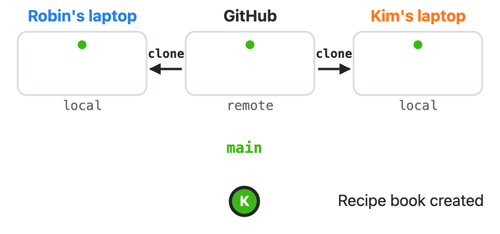
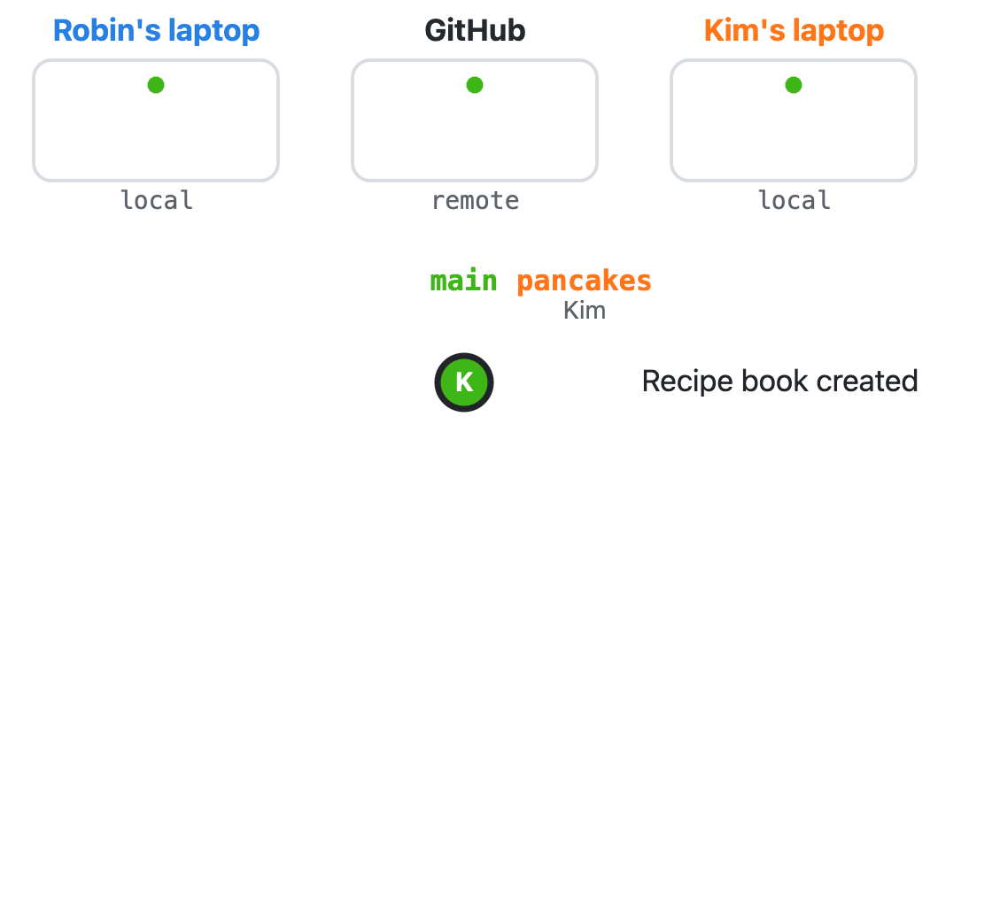
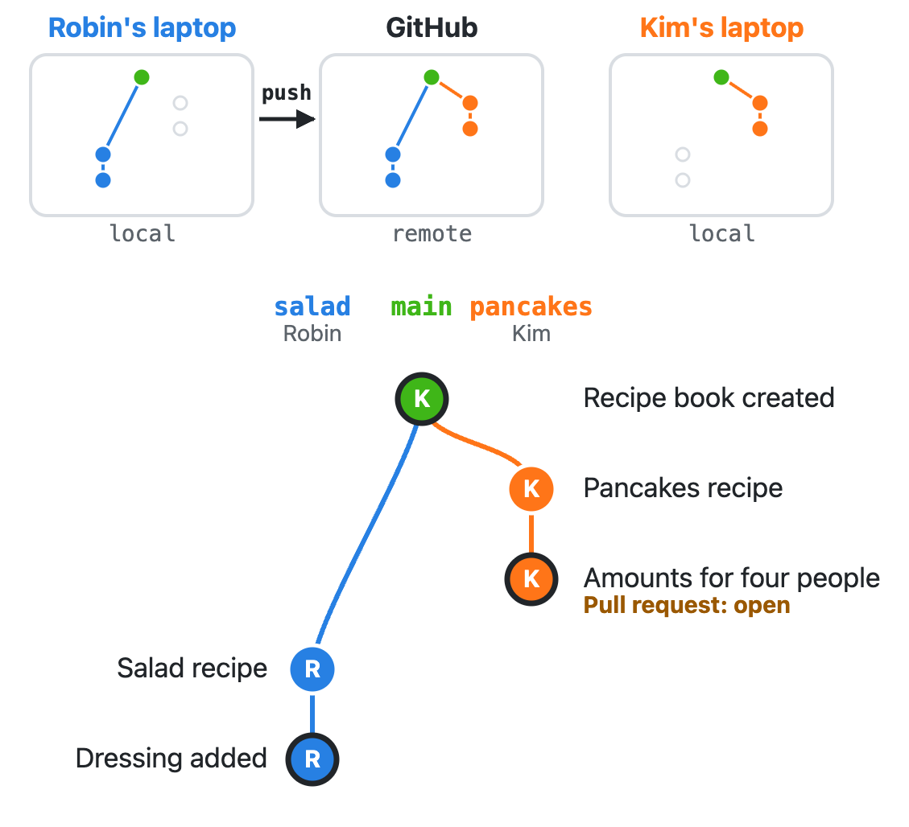
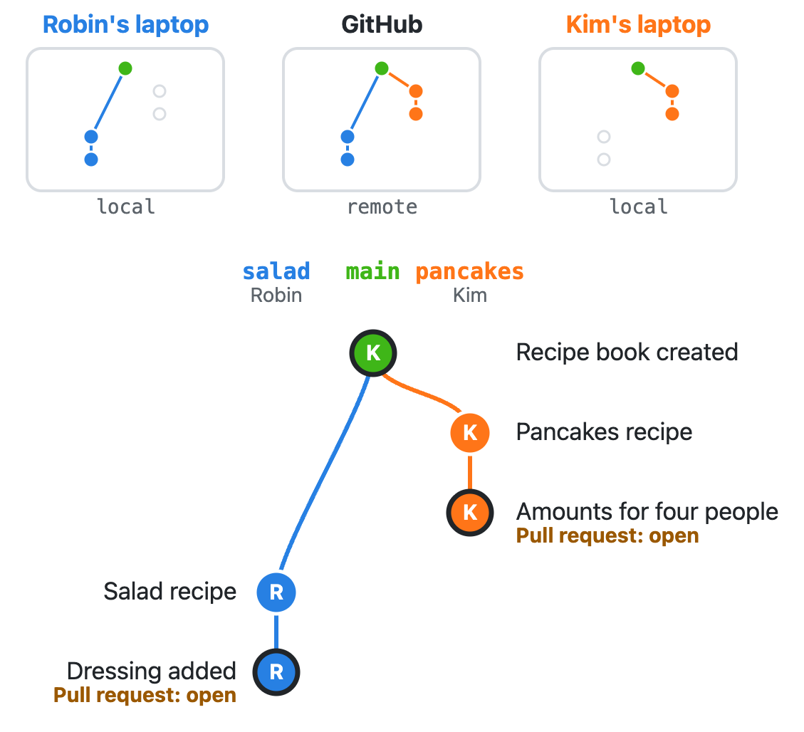
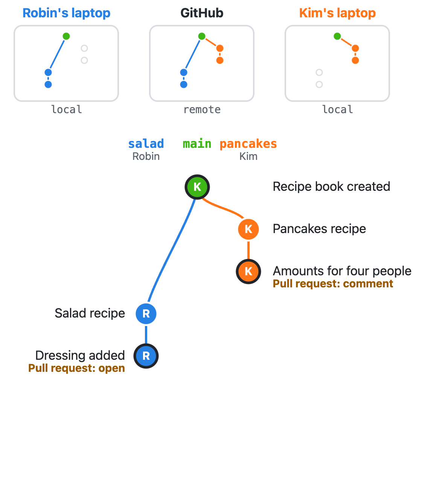
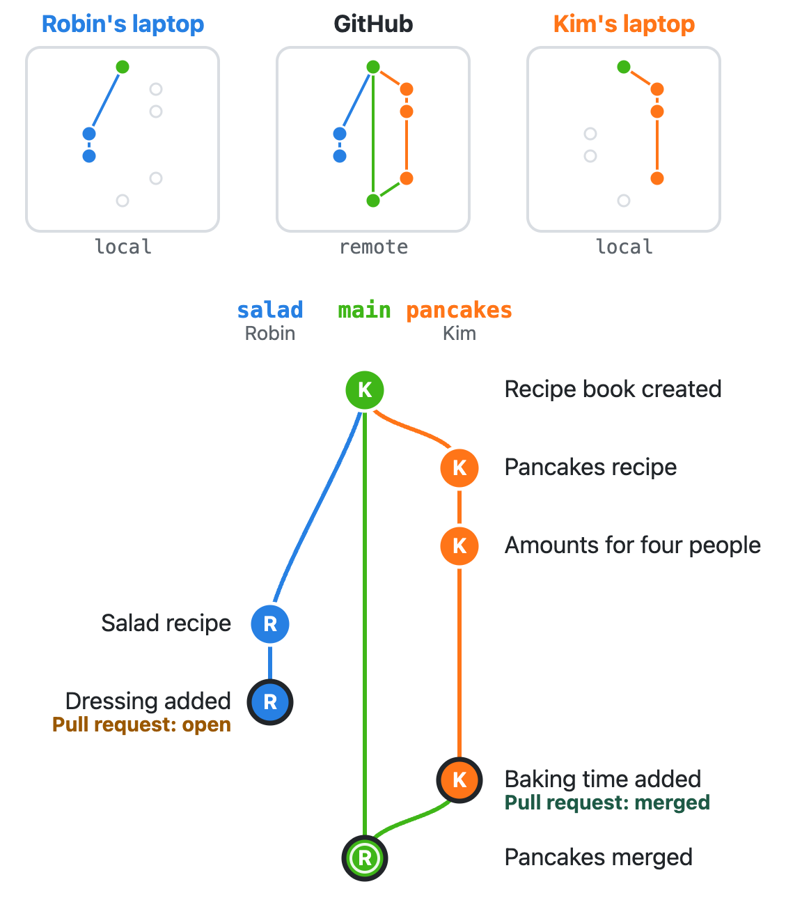

<!--
Slides for Git for Scientists at the Research Data Conference 2026, Friday
20 November 2026, 09:30 to 11:30, Bern. A port of the deck of the German
course of 17 November 2026 (My turn, Our turn, Your turn). The story
pictures are stills of the two-person story (Kim and Robin), translated,
one canvas per block: images/story-01 and 02, 03 to 12, 13 to 16.
The numbers on the slide "Your preparation, in counts" are updated on
Friday morning from the tracker.
Render: quarto render workshop/slides.qmd
-->

# Welcome {background-color=""}

## Two seats today {.smaller}

You sit on two seats at the same time.

::::: columns
::: {.column width="49.5%"}
### Learner

09:40 to 10:55

You take a file of your own through one full loop: branch, commit, pull request, review, merge.
:::

::: {.column width="49.5%"}
### Educator

11:00 to 11:30

You look at how this workshop is built and run, and what you would keep or change for your own teaching.
:::
:::::

::: task
The **watching sheet** on your table is for the educator seat. Write on it from now on: a moment where you were lost or waiting, one thing you would keep, one thing you would change.
:::

::: {.notes}
09:30, 4 minutes. Say both seats out loud. Hold up the watching sheet. The notes on it are the material for 11:00.
:::

## Find your neighbour {.smaller}

::: task
Raise your hand if you **use Git every week**.

Now look around. If you have never used Git, sit beside a raised hand. Move now, with your laptop.
:::

::: incremental
-   You work in pairs today, each person on their own laptop.
-   Pre-work not finished? Sit with a neighbour who has it. You follow on their laptop and you are the reviewer of their pull request.
:::



::: {.notes}
09:34, 3 minutes. The count from 09:00 decides how many pairs have one prepared laptop only. People who use Git weekly sit beside first-time users.
:::

## You have done the important part already

::: incremental
-   A repository of your own, three lines about your teaching, a clone, a commit from your laptop: in about an hour.
-   Today we walk through the same steps together and add the part that needs a second person.
-   This is [not]{.mark-word} a course about AI. What agents such as Claude Code do in a repository rests on exactly these steps.
-   Things may [go wrong]{.mark-word} here. Everything we do today can be undone.
:::

::: {.notes}
09:37. The pre-work has already taught what the workshop shows. Two anchor sentences out loud: not an AI course, everything can be undone.
:::

## Who is in the room {.smaller}

From your 26 answers in the survey:

::: {.numbers}
::: {.number}
[10]{.big}

do not use Git today
:::

::: {.number}
[13]{.big}

use Git regularly or extensively
:::

::: {.number}
[16]{.big}

teach Git or plan to
:::
:::

A mixed room. That is why you sit in pairs, and why the second half of the workshop is about teaching.

::: {.notes}
Counts from the survey, answers with consent, totals only. 10 data stewards, 5 researchers, 2 librarians, others. 14 macOS, 11 Windows, 1 Linux.
:::

## How we work {.smaller}

Three ways of working. The one that applies is at the top of the slide.

[My turn]{.turn .my} I show something on my screen. You watch and type nothing.

[Our turn]{.turn .our} We do the same step at the same time: I on my screen, you on yours.

[Your turn]{.turn .your} You work in pairs on a task. I help where it sticks.

## Today {.smaller}

| Time  | What                                                       |
|-------|------------------------------------------------------------|
| 09:30 | Two seats, your neighbour                                  |
| 09:40 | What is a commit? One repository, several places           |
| 09:50 | Your commits in GitHub Desktop and on GitHub               |
| 10:00 | Branch and pull request                                    |
| 10:08 | I show it: a file goes into the shared repository          |
| 10:20 | Your turn: your file as a pull request                     |
| 10:40 | Review and merge, in pairs                                 |
| 10:55 | Break                                                      |
| 11:00 | Educator seat: how this workshop is built, and your notes  |

::: aside-line
The schedule is tight. Questions that have no room go on a sticky note for 11:00.
:::

# The commit {background-color=""}

## What is a commit?

A commit is a saved state of your files, with four pieces of information:

::: incremental
-   **Who** made it: a name and an email address
-   **When**: date and time
-   **What** changed: line by line
-   **Why**: the message you write with it
:::

::: {.notes}
09:40, 3 minutes. Key words only, then the traces in a real repository on the next slide.
:::

## Traces in a real repository {.smaller}

[My turn]{.turn .my}

The website of this workshop, public on GitHub: `gitforsci-rdc/website`

-   **14 commits** from 9 to 17 November
-   9 November: "pre-work site for the RDC 2026 iteration, steps 1 and 2 visible"
-   15 November, a Sunday, 22:00: "pre-work steps 3 to 5 for the GitHub Desktop route"
-   17 November: "pre-work step 6, your own repository and first commit"

::: task
A question for you: **When were your instructions written?**
:::

::: {.fragment}
9 of the 14 commits are from the last three days, 4 of them after 22:00.
:::

Git forgets nothing. That is the use of it, and it is the reason to choose what goes into a commit.

::: {.notes}
09:43, 3 minutes. No browser needed, the slide carries it. The history shows that my instructions came late. This returns at 11:00.
:::

## One repository, several places

::: {.r-stack}
{.fragment .fade-in width="88%" fig-alt="Three boxes: Robin's laptop and Kim's laptop are empty and dashed, with the words no copy yet. The box GitHub holds one commit. Below the laptops stands local, below GitHub stands remote. Underneath, the commit graph with the first commit on main."}

{.fragment .fade-in width="88%" fig-alt="From GitHub, one arrow with the word clone points to Robin's laptop and one to Kim's laptop. All three boxes now hold the same commit."}
:::

::: legend
Pictures: Lars Schöbitz, CC BY 4.0
:::

::: {.notes}
09:46, 4 minutes. Kim creates the repository on GitHub. Kim and Robin clone: three places, the same state. Laptops never talk to each other directly, always through GitHub. Words: local is the laptop, remote is GitHub. Clone once. A second clone is a second copy on the same laptop, and the two get mixed up.
:::

## Your commits in GitHub Desktop {.smaller}

[Our turn]{.turn .our}

::: task
1.  Open **GitHub Desktop**.
2.  Choose your repository `teaching-your-username` at the top left.
3.  Click the tab **History**.
:::

You see your own commits from the pre-work: who, when, what, why.

::: aside-line
Do you see three commits? Thumbs up.
:::

::: {.notes}
09:50, 3 minutes. Whoever has not finished the pre-work looks at the neighbour's screen. Show the same view in the demo repository.
:::

## Commits on GitHub {.smaller}

[My turn]{.turn .my}

I show the repository `teaching-rainbow-train` in the browser.

-   From GitHub Desktop to GitHub: menu **Repository**, **View on GitHub**
-   The list of commits: the clock with the number
-   One commit up close: who, when, what, why
-   **Verified** beside a commit: it was made in the browser, and GitHub signed it. A commit from your laptop has no such mark. Both are fine.

::: {.notes}
09:53, 4 minutes. I show GitHub and explain, the room watches. Then the next slide: your turn, 3 minutes.
:::

## Your commits on GitHub {.smaller}

[Your turn]{.turn .your}

::: task
1.  In GitHub Desktop: menu **Repository**, **View on GitHub**. Your repository opens in the browser.
2.  Click the clock with the number above the list of files on the right, for example **3 Commits**.
3.  Show your neighbour one commit: who, when, what, why.
:::

The same commits as in GitHub Desktop. Your laptop and GitHub hold the same state.



::: {.notes}
09:57, 3 minutes, each person on their own laptop.
:::

## A button is a command {.smaller}

[My turn]{.turn .my}

GitHub Desktop runs commands for you. In a terminal, in RStudio, in Positron and in VS Code they carry these names:

| In GitHub Desktop         | The command   |
|---------------------------|---------------|
| History                   | `git log`     |
| Changes                   | `git status`  |
| Commit to main            | `git commit`  |
| Push origin               | `git push`    |
| Fetch origin, Pull origin | `git pull`    |

::: aside-line
What you learn today carries over to the tool you teach with.
:::

::: {.notes}
10:00, 2 minutes. No live terminal. One sentence: an agent such as Claude Code works with the same commands.
:::

# Branch and pull request {background-color=""}

## Create a branch, then open a pull request

::: {.r-stack}
{.fragment .fade-in width="58%" fig-alt="Kim has created the branch pancakes. Beside main, the graph has a column pancakes, without a commit of its own yet."}

{.fragment .fade-in width="58%" fig-alt="A first commit on the branch pancakes, drawn dashed. It exists only in the box Kim's laptop."}

{.fragment .fade-in width="58%" fig-alt="A second commit on the branch pancakes, amounts for four people, also dashed and only on Kim's laptop."}

{.fragment .fade-in width="58%" fig-alt="An arrow with the word push points from Kim's laptop to GitHub. The two commits of the branch are now solid and also on GitHub."}

{.fragment .fade-in width="58%" fig-alt="Kim has opened a pull request. Below the newest commit of the branch pancakes stands Pull request: open. The graph is otherwise unchanged."}
:::

::: legend
**K** is Kim, **R** is Robin. Dashed: only on the laptop. Dark border: the newest commit of a branch.
:::

::: {.notes}
10:02, 6 minutes for this slide and the next. Branch: a line of work of your own, main stays untouched. A commit, another commit, only then the push: solid, now also on GitHub. Pull request: the request to take the branch into main. In the picture it stands below the newest commit.
:::

## Robin works at the same time

::: {.r-stack}
{.fragment .fade-in width="58%" fig-alt="Robin has created the branch salad on the left, without a commit of its own yet."}

{.fragment .fade-in width="58%" fig-alt="Robin's first commit, salad recipe, dashed and only on Robin's laptop."}

{.fragment .fade-in width="58%" fig-alt="Robin's second commit, dressing added, also only on Robin's laptop."}

{.fragment .fade-in width="58%" fig-alt="An arrow with the word push points from Robin's laptop to GitHub. Robin's two commits are now also on GitHub."}

{.fragment .fade-in width="58%" fig-alt="Robin has opened a pull request too. Below the newest commits of both branches stands Pull request: open. Robin's laptop lacks Kim's commits, Kim's laptop lacks Robin's commits. GitHub holds all of them."}
:::

::: {.notes}
The same steps for Robin, one after the other. Last picture: each person has a branch of their own, which is why yours is named people-username. GitHub holds everything, each laptop only its own work.
:::

# The shared repository {background-color=""}

## From your repository into the shared one {.smaller}

::::: columns
::: {.column width="49.5%"}
### Before

-   Your three lines are in your own repository `teaching-your-username`, in the file `your-username.md`
-   Only you write there
:::

::: {.column width="49.5%"}
### After

-   The same file is also in the shared repository `workshop`, in the folder `people`, on a branch of your own
-   A pull request asks to take it into `main`
-   Your neighbour reads it, and merges it
:::
:::::

::: aside-line
You copy the file. Never the repository folder: it carries a hidden folder `.git`, and Git then sees a repository inside a repository.
:::

## A file goes into the shared repository {.smaller}

[My turn]{.turn .my}

::: aside-line
Lean back and watch. I work with the account rainbow-train, as a participant like you.
:::

1.  Open the repository `workshop` and click **Fetch origin**
2.  Create the branch `people-rainbow-train`
3.  Copy the file `rainbow-train.md` into the folder `people`
4.  Commit
5.  Publish the branch
6.  Open the pull request and request a reviewer

::: {.notes}
10:08, 12 minutes, in two passes. First pass without stopping, about 4 minutes. Second pass slowly, and say these out loud before they meet them:
1. You cloned workshop in Step 5. Do not clone it again. Current Repository, workshop.
2. Current Branch, New Branch. The button at the bottom left must end in "to people-your-username". If it ends in "to main", you are on the wrong branch.
3. In Finder or Explorer: gitrepos/teaching-username, copy the one file, paste into gitrepos/workshop/people. The file, never the folder.
4. Changes shows one file with a tick.
5. Publish branch.
6. Preview Pull Request, then Create Pull Request at the bottom right. The browser opens. Fill in the two lines. On the right, Reviewers: the username of your neighbour.
Fallback: if at 10:30 fewer than half of the pairs have a published branch, stop the hands-on, keep my own pull request on screen and say that the detailed page carries these steps for later. The review then runs as a demo with one volunteer.
:::

## Your file as a pull request {.smaller}

[Your turn]{.turn .your}

::: aside-line
Open this page first: [gitforsci-rdc.github.io/website/workshop/add-your-file.html](https://gitforsci-rdc.github.io/website/workshop/add-your-file.html). It has all the steps, also when this slide is gone.
:::

::: task
In pairs, 20 minutes, back at **10:40**.

1.  Go through steps 1 to 5 on the page, both at the same time, each on your own laptop.
2.  Request your neighbour as the reviewer.
3.  **Do not merge yet.** Reading by a second person is the point of the exercise.
:::

Stuck? Raise your hand, I come to you.



::: {.notes}
10:20, 20 minutes, protected block. Walk the room. One prepared laptop in a pair: the owner does the steps, the neighbour reads the page out loud and becomes the reviewer.
Push rejected: the commit carries the real email address, and the account blocks such pushes. In GitHub Desktop: Settings (Windows: File, Options), Git, tab Author, choose the address ending in users.noreply.github.com, Save. Then Undo at the bottom of Changes and commit again.
:::

# Review and merge {background-color=""}

## A second person reads

[My turn]{.turn .my}

::: {.r-stack}
{.fragment .fade-in width="46%" fig-alt="Robin has read Kim's pull request and written a comment. Below Kim's newest commit stands Pull request: comment."}

{.fragment .fade-in width="46%" fig-alt="Kim has answered with one more commit, baking time added. It is dashed and only on Kim's laptop."}

{.fragment .fade-in width="46%" fig-alt="Kim has pushed. The commit baking time added is now also on GitHub and belongs to the open pull request."}

{.fragment .fade-in width="46%" fig-alt="The pull request is merged. On main there is a merge commit that takes in Kim's three commits. Below Kim's newest commit stands Pull request: merged. The merge commit exists only on GitHub."}
:::

::: {.notes}
10:40, 5 minutes. Comment, commit, push, merge, one after the other. Then live in the browser: as larnsce, open the pull request of rainbow-train, Files changed, one comment on the line "What blocks me". As rainbow-train, answer with a commit and push. As larnsce, merge.
:::

## Review your neighbour's pull request {.smaller}

[Your turn]{.turn .your}

::: task
In pairs, 10 minutes. The steps are in step 6 of the page.

1.  **Reviewer:** open your neighbour's pull request, tab **Files changed**. Write one question as a comment on the line `What blocks me`.
2.  **Author:** answer in the file on your laptop, commit, **Push origin**. The open pull request shows the new commit.
3.  **Reviewer:** click **Merge pull request**, then **Confirm merge**.
4.  **Both:** in GitHub Desktop switch to `main` and click **Fetch origin**, then **Pull origin**.
:::

::: aside-line
After the pull, the folder `people` on your laptop holds the files of everyone who is merged.
:::



::: {.notes}
10:45, 10 minutes. The pull at the end is the moment to name: other people's work arrives on your laptop.
:::

## Break

Until 11:00.



::: aside-line
Take your watching sheet with you. After the break you compare it with your neighbour's.
:::

# The educator seat {background-color=""}

## How this workshop is built {.smaller}

Everything you used this week is a repository.

| What you saw                          | What it is                                                       |
|---------------------------------------|------------------------------------------------------------------|
| The website with the six steps        | A repository, built into a site on every merge                   |
| The survey                            | A small app, its answers in a database                           |
| The invitation to the organisation    | A script that reads the usernames from the survey                |
| Your issue with five boxes            | A script, one issue per person from one template                 |
| The comment after you ticked a box    | A watcher that looks every 10 minutes and tells me what changed  |
| These slides                          | A text file in the same repository as the website                |

::: aside-line
One course organisation on GitHub for you, one for the material, one for the administration. The next cohort gets a new copy of the first one.
:::

::: {.notes}
11:00, 5 minutes. One sentence per row. The point: the workshop teaches the tool it is built with, and every step you took left a trace I could see without asking.
:::

## Your preparation, in counts {.smaller}

<!-- COUNTS: update on Friday 20 November, 08:30, from the tracker -->

Tuesday 17 November, 15:00. Four emails, the last three on 15, 16 and 17 November.

::: {.numbers}
::: {.number}
[27]{.big}

answered the survey
:::

::: {.number}
[15]{.big}

joined the organisation
:::

::: {.number}
[7]{.big}

finished steps 3 to 5
:::

::: {.number}
[2]{.big}

made the first commit from the laptop
:::
:::

::: {.fragment}
This is what preparation looks like in most courses: several reminders, and most of the work in the last hours. This time also because my instructions came late.
:::

::: {.notes}
11:05, 3 minutes. Counts only, no names, no chart of who worked when. Read the Friday numbers out loud and compare them with Tuesday. Say that the pre-work decided who could type today.
:::

## The same design, three days ago {.smaller}

On Tuesday I ran this design in German, online, for 16 people who do not write code.

::: incremental
-   **13 pull requests** in two hours, from people who had never used Git
-   **Three clones** of one repository on one laptop: "clone once" is now a sentence in your Step 6
-   **A copied repository folder**, with its hidden `.git`: today you copied one file
-   **The real email address** in most first commits, although the account said private: the setting in GitHub Desktop comes first
-   **Too many emails** before the workshop
:::

::: {.notes}
11:08, 3 minutes. The second cohort stays unnamed. Each line is a change you met this week: the instructions you followed are three days old.
:::

## Why GitHub Desktop? {.smaller}

Your preference in the survey:

::: {.numbers}
::: {.number}
[11]{.big}

RStudio
:::

::: {.number}
[6]{.big}

GitHub Desktop
:::

::: {.number}
[4]{.big}

Positron
:::

::: {.number}
[5]{.big}

no preference
:::
:::

I chose against the largest group. Half of the room does not write code in R, and 10 of you do not use Git today. GitHub Desktop needs no programming language, and its buttons carry the names of the commands.

::: {.notes}
11:11, 2 minutes. The honest version: the choice has a cost for the 11. Ask for it on the sticky notes.
:::

## Compare your watching sheets {.smaller}

[Your turn]{.turn .your}

::: task
In pairs, 5 minutes.

1.  Read each other's watching sheet.
2.  Agree on **one** thing and write it on **one** sticky note, in a full sentence.
3.  Bring it to the wall, under one of three headings: **Keep**, **Change**, **Missing**.
:::



::: {.notes}
11:13, 5 minutes for the pairs, then 5 minutes at the wall: read three notes per heading out loud, ask one pair to say more. The sheets stay with me if people agree.
:::

## Would you teach this? {.smaller}

I offer a workshop for people who teach Git and GitHub: this course design, its scripts and the material, for you to run with your own groups.

::: task
Answer with a commit, in your own repository `teaching-your-username`:

1.  Open the file `your-username.md` and add one line:

    `- Teach the teachers: yes / maybe / no. What I would need:`

2.  Commit to main, then **Push origin**.
:::



::: aside-line
Half a day, online, spring 2027. Your answer commits you to nothing.
:::

::: {.notes}
11:23, 5 minutes. The form of the offer (half a day, online, spring 2027) is a placeholder until I have named it. The answers arrive as commits, which I can read with the same watcher.
:::

# Thank you {background-color=""}

## Thank you

Everything stays open after today:

-   The website and these slides: <https://gitforsci-rdc.github.io/website/>
-   The steps of today: <https://gitforsci-rdc.github.io/website/workshop/add-your-file.html>
-   The material is licensed CC BY 4.0. Take it, change it, teach with it.

Slides made with revealjs and Quarto: <https://quarto.org/docs/presentations/revealjs/>

::: {.notes}
11:28. Collect the watching sheets. Questions on sticky notes that had no room get an answer by email.
:::
